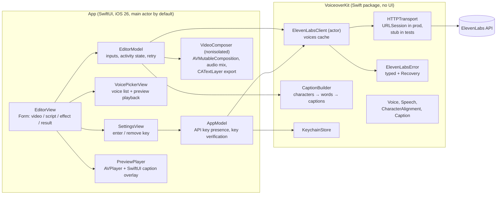
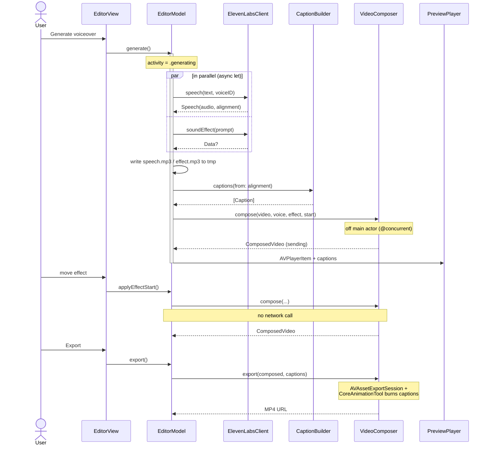
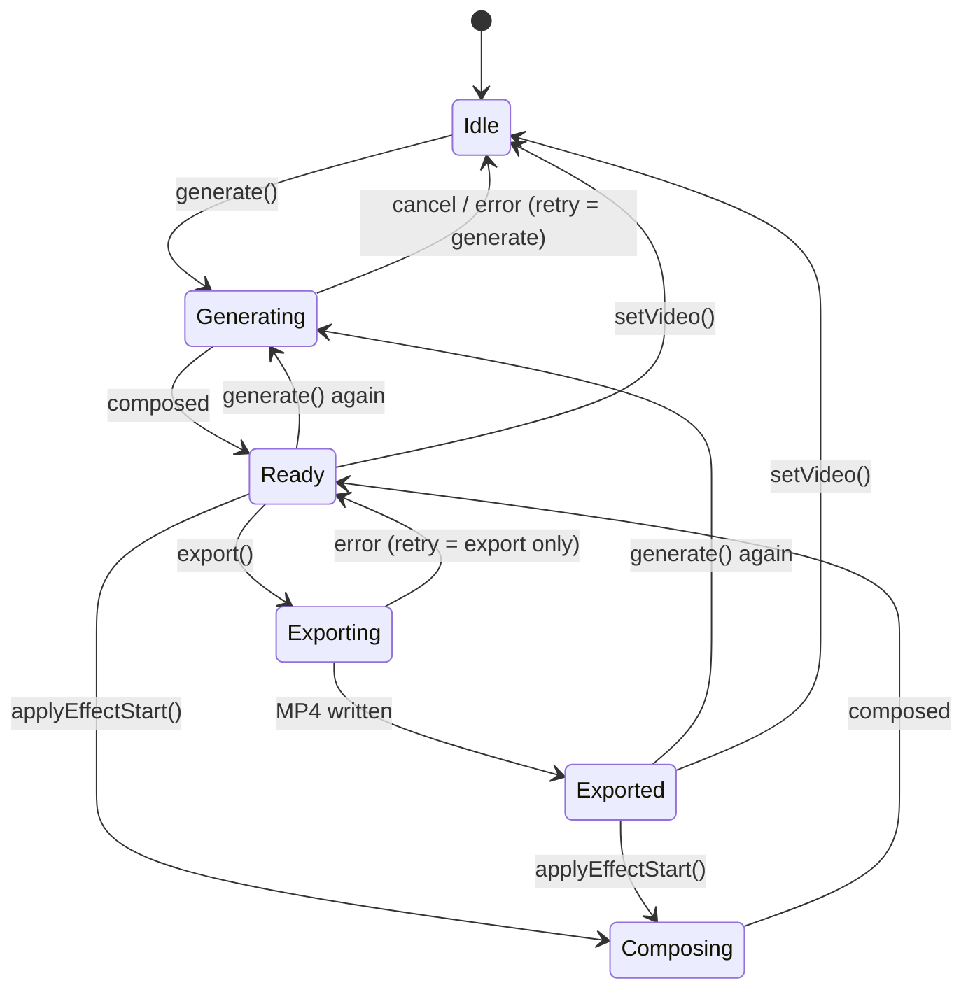
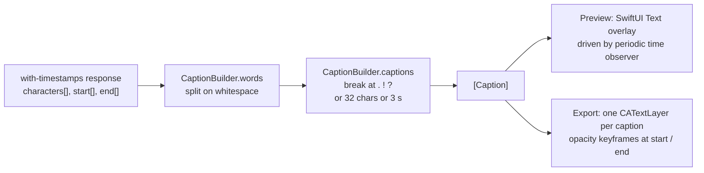

# Voiceover Studio

Add an AI voiceover, word-synced captions and a generated sound effect to any short video, powered by the
[ElevenLabs API](https://elevenlabs.io/docs).

<!-- TODO: demo GIF (pick clip → write script → choose voice → export) -->

**Flow:** pick a video from Photos → write a script → choose a voice → (optional) describe a sound effect →
preview with live captions → export an MP4 with captions burned in.

## Architecture

Two layers with a one-way dependency. The app owns UI, state and AVFoundation; `VoiceoverKit` owns the
network, parsing and caption maths, and has no UI imports, so it is tested with plain `swift test`.

### Generate flow

Voice and sound effect are requested in parallel. Generated audio is written to disk once, so moving the
effect on the timeline only re-composes and never calls the API again.

### Editor state

`activity` is `nil` in Idle / Ready / Exported; a `Failure` carries the exact closure to retry, so an
export error never re-spends generation credits.

### Captions: two renderers, one source

## Engineering notes

- **Captions come from character timestamps, not guesswork.** The `with-timestamps` endpoint returns start and end
  times for every character. `CaptionBuilder` groups them into words, then into short lines. Lines break at sentence
  punctuation, at 32 characters or at 3 seconds, so captions are always readable and in sync with the voice.
- **One edit, two renderers.** `AVVideoCompositionCoreAnimationTool` only works for offline export. The preview
  therefore draws the same captions as a SwiftUI overlay, driven by the player's time, and the export burns them in
  with `CATextLayer`s. Both read the same `[Caption]`.
- **Parallel requests.** Voice and sound effect don't depend on each other, so they are fetched with `async let`.
  Generated audio is kept on disk, so moving the sound effect on the timeline only re-composes and never calls the
  API again.
- **Errors you can act on.** HTTP and network failures map to `ElevenLabsError`: invalid key, quota, rate limit,
  validation, server, offline. Each case carries a user-facing message and a recovery action (open Settings, retry,
  edit input). A retry repeats only the step that failed, so retrying an export doesn't spend credits.
- **Swift 6 strict concurrency.** Main-actor-by-default isolation in the app; the networking client is an
  actor that owns the voice cache; the package builds in Swift 6 language mode.
- **Bring your own key.** No key in the bundle or the repo. The key is entered once, verified with a cheap request
  and stored in the Keychain (`AfterFirstUnlockThisDeviceOnly`).

## Run it

1. Get an API key at elevenlabs.io → Developers → API Keys. The free tier is enough. Text to Speech, Voices and
   Sound Effects permissions are all you need.
2. `brew install xcodegen && xcodegen generate && open VoiceoverStudio.xcodeproj`
3. Run on an iOS 26+ simulator or device, open Settings and paste the key.

Tests: `swift test --package-path Packages/VoiceoverKit`

## Roadmap

- Streaming TTS over WebSocket, so playback starts before generation finishes
- Multiple voices (dialogue)
- Auto-ducking of the sound effect under speech
- Waveform timeline with drag to position the effect
