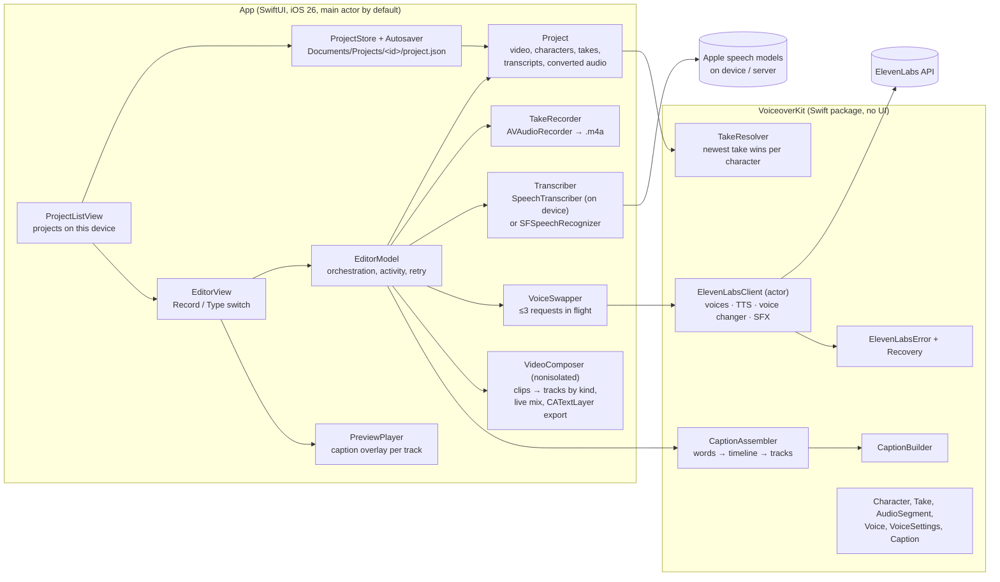
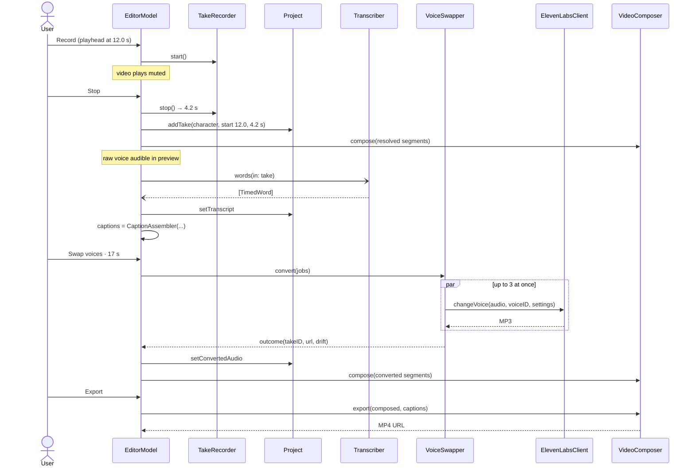
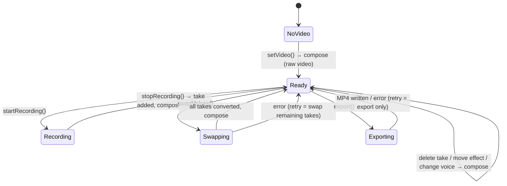
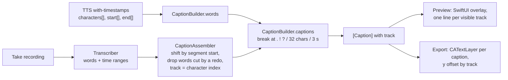

# Voiceover Studio

Record a voiceover over any short video in your own voice, then swap it for an ElevenLabs voice. Timing,
pauses and delivery stay yours; captions follow the words. Several characters can talk, even over each
other. Powered by the [ElevenLabs API](https://elevenlabs.io/docs) and on-device speech recognition.

<!-- TODO: demo GIF (pick clip → record takes → swap voices → export) -->

**Record mode:** pick a video → add characters and give each a voice → scrub to a moment, press Record,
speak, stop (or let the video's end stop it); repeat per line and per character → drop generated sound effects
on their own lane → describe background music and ElevenLabs composes it to the length of the export → Swap voices →
export an MP4 with captions burned in.

**Type mode:** write a script, pick a voice, generate, export.

## Architecture

Design notes with the reasoning live in [`docs/`](docs/README.md): architecture, Swift concurrency
decisions, the media pipeline, takes and the timeline, persistence, the ElevenLabs integration and a
candid list of known issues.

Two layers with a one-way dependency. The app owns UI, state, recording and AVFoundation; `VoiceoverKit`
owns the network, parsing and the pure timeline maths (overlap resolution, caption assembly), has no UI
imports and is tested with plain `swift test`.

### Record flow

### Takes, characters and overlap

```mermaid
gantt
    dateFormat ss
    axisFormat %S s
    title Two characters, one redo. Narrator's second take replaces the overlap; the dog is untouched.
    section Narrator
    take 1 (seq 1)        :a1, 00, 10s
    take 3 (seq 3, redo)  :crit, a3, 06, 6s
    section Dog
    take 2 (seq 2)        :b1, 04, 3s
    section Heard
    Narrator take 1 [0–6) :done, h1, 00, 6s
    Narrator take 3 [6–12) :done, h3, 06, 6s
    Dog take 2 [4–7)      :done, h2, 04, 3s
```

`TakeResolver` applies "newest take wins" only within a character. Each surviving slice becomes an
`AudioClip` on its own track, so characters can overlap like a real dialogue. Converted audio keeps the
take's timing, so the same offsets apply before and after the swap.

### Editor state

Transcription runs beside the state machine, one task per take; a failed transcription offers a retry
without touching the audio. A voice change on a character invalidates only that character's conversions.

### Captions: one source, two renderers

## Engineering notes

- **Your timing, their voice.** Speech-to-speech keeps the pauses, emphasis and pace of the recording, so
  there is no script-to-timeline problem to solve: you just talk over the video. The app checks the
  converted length against the take and flags drift above 150 ms, because captions are timed from the
  recording.
- **Speech recognition picks the engine per language.** `SpeechTranscriber` (iOS 26) runs on device
  but covers English, German, French, Spanish, Italian, Portuguese, Japanese, Korean and Chinese only.
  Other languages, Russian included, go through `SFSpeechRecognizer`, which may use Apple's servers.
  One `Transcriber` hides the choice.
- **A project is a folder.** `Documents/Projects/<id>/` holds `project.json` and every media file: the
  video, takes, converted audio, effects, speech and the export. Files are referenced by name because iOS
  moves the app container between launches. An autosaver watches the project through Observation and
  writes the manifest 600 ms after any change; nothing to press.
- **Credits are spent on purpose.** Nothing calls ElevenLabs until you press Swap voices, the button
  says how many seconds it will bill, and only takes without a current conversion are sent. Changing a
  character's voice invalidates just that character.

- **TTS captions come from character timestamps, not guesswork.** The `with-timestamps` endpoint returns start and end
  times for every character. `CaptionBuilder` groups them into words, then into short lines. Lines break at sentence
  punctuation, at 32 characters or at 3 seconds, so captions are always readable and in sync with the voice.
- **One edit, two renderers.** `AVVideoCompositionCoreAnimationTool` only works for offline export. The preview
  therefore draws the same captions as a SwiftUI overlay, driven by the player's time, and the export burns them in
  with `CATextLayer`s. Both read the same `[Caption]`.
- **Parallel requests.** Voice and sound effect don't depend on each other, so they are fetched with `async let`.
  Generated audio is kept on disk, so moving the sound effect on the timeline only re-composes and never calls the
  API again.
- **Errors you can act on.** HTTP and network failures map to `ElevenLabsError`: invalid key, quota, rate limit,
  validation, server, offline. Each case carries a user-facing message and a recovery action (open Settings, retry,
  edit input). A retry repeats only the step that failed, so retrying an export doesn't spend credits.
- **Swift 6 strict concurrency.** Main-actor-by-default isolation in the app; the networking client is an
  actor that owns the voice cache; the package builds in Swift 6 language mode.
- **Bring your own key.** No key in the bundle or the repo. The key is entered once, verified with a cheap request
  and stored in the Keychain (`AfterFirstUnlockThisDeviceOnly`).

## Run it

1. Get an API key at elevenlabs.io → Developers → API Keys. The free tier is enough. Give the key these
   permissions: Text to Speech, Speech to Speech (Voice Changer), Voices, Sound Effects and Music. A key without one
   of them gets a "missing permission" error naming it when that feature is used.
2. `brew install xcodegen && xcodegen generate && open VoiceoverStudio.xcodeproj`
3. Run on an iOS 26+ simulator or device, open Settings and paste the key. Pick the recording language
   there too if it differs from the device language.

`Scripts/check.sh` runs lint, the translation check, the package tests and the app tests on a simulator.
`Scripts/strings.sh` re-extracts the strings after a text change and fills Russian and Ukrainian from
`Scripts/translations.py` (see [docs/localization.md](docs/localization.md)). `Scripts/install-sim.sh [video]`
reinstalls the debug build on the booted simulator; with a video path it opens the recorder directly.

## Roadmap

- Drag a take or an effect along its lane to move it
- Trim silence at the edges of a take
- Remove filler words via on-device Foundation Models, cutting the audio by word timing
- Hear other characters' takes while recording a reply
- Auto-ducking of effects under speech
