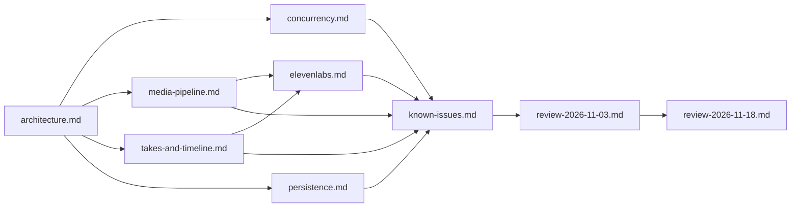

# Voiceover Studio — engineering docs

Design notes and the reasoning behind them. One file per aspect. Every file opens with an **At a glance**
box and a diagram, so you can skim the boxes first and read the body only where you need it.

## Reading order

| File | What it answers |
|---|---|
| [architecture.md](architecture.md) | Layers, folders, dependency injection and navigation, who owns what, how a session flows, the job state machine |
| [concurrency.md](concurrency.md) | Swift 6 strict concurrency: isolation defaults, `nonisolated`, `@concurrent`, `sending`, actors, `isolated deinit` |
| [media-pipeline.md](media-pipeline.md) | AVFoundation: composition, clips and tracks, the live mix, preview vs export, rotation, captions, audio session |
| [takes-and-timeline.md](takes-and-timeline.md) | Takes, characters, overlap resolution, recording, waveforms, transcription, voice swap, the scrubber |
| [persistence.md](persistence.md) | Project folders, the manifest, loading, autosave, invalidation and file lifecycle |
| [elevenlabs.md](elevenlabs.md) | Endpoints, key permissions, error model, voice settings, credits, timing drift |
| [localization.md](localization.md) | String catalogs, the English/Russian/Ukrainian tables, plurals, how to add a string |
| [known-issues.md](known-issues.md) | Limits, shortcuts and debt, with the reason each one is still there |
| [review-2026-11-03.md](review-2026-11-03.md) | Full code review and what was done about each finding |
| [review-2026-11-18.md](review-2026-11-18.md) | Architecture review before publishing: navigation, DI, the music and auto-stop features |

## Vocabulary

| Term | Meaning |
|---|---|
| **Kit** | `Packages/VoiceoverKit`: the UI-free Swift package, tested with `swift test` on macOS |
| **App** | The SwiftUI target. AVFoundation, Speech, Photos live only here |
| **Take** | One microphone pass: a file, a start on the timeline, a duration, a character |
| **Segment** | The audible slice of a take after overlap resolution |
| **Clip** | What the composer receives: a file, a start, a source offset, a duration, a kind |
| **Job** | A step that spends credits or minutes: swap, export, generate, effect, Photos save |

Times on the timeline are seconds as `Double`; `CMTime` appears only at AVFoundation boundaries.

## How decisions are written up

Each non-obvious choice is a **Decision** block:

> **Decision.** What was chosen.
> **Why.** The constraint or bug that forced it.
> **Rejected.** What else was tried or considered and why it lost.

Grep for `**Decision.**` to list all of them.
