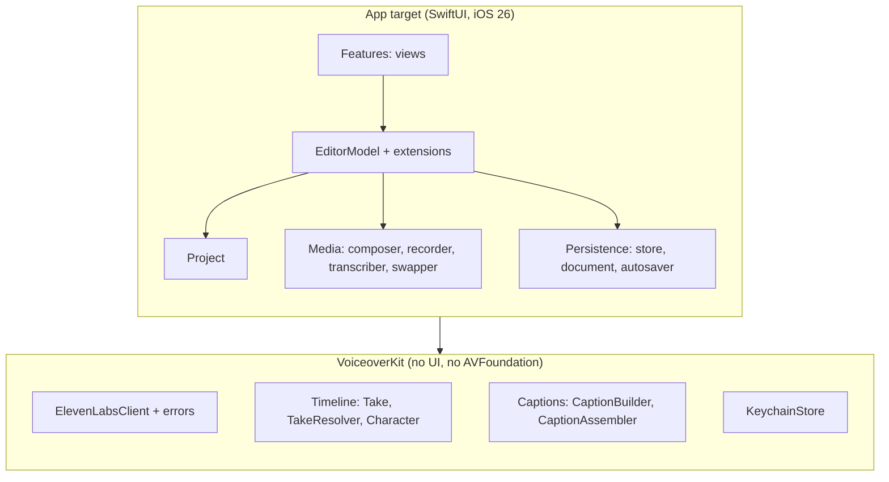
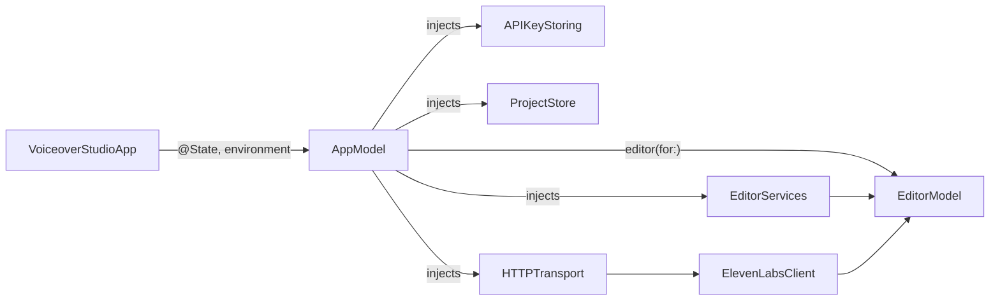
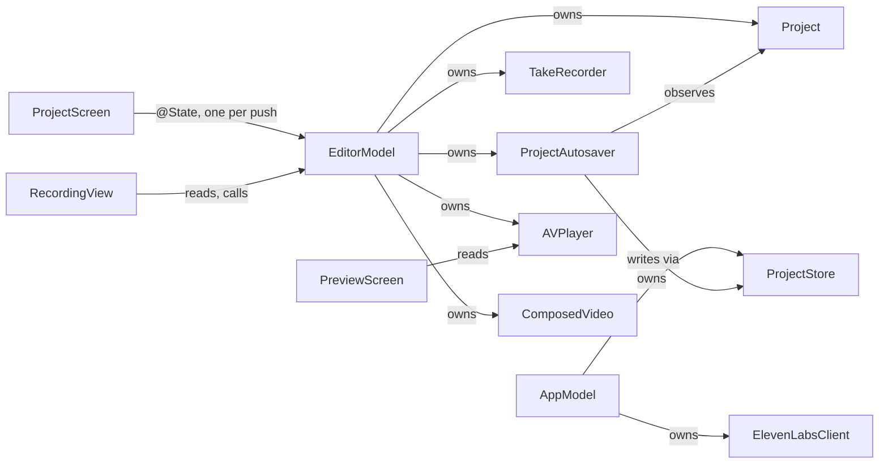
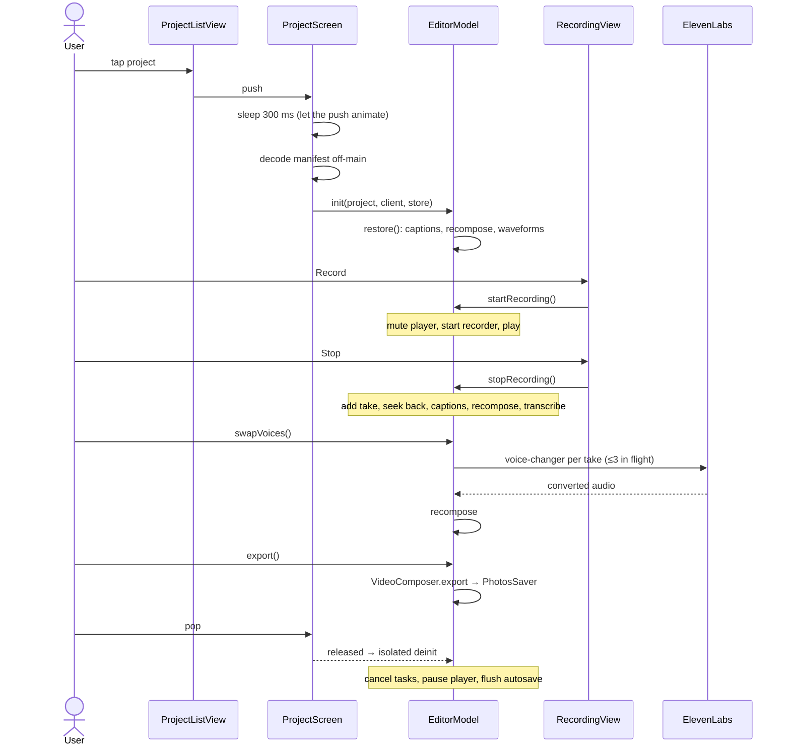
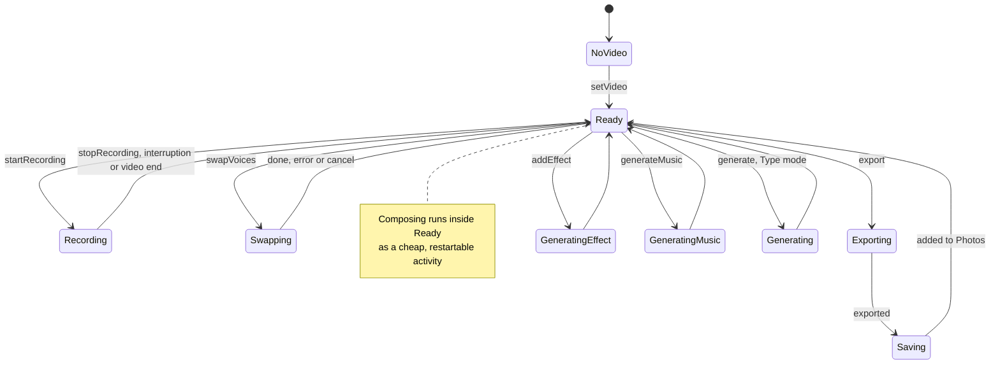
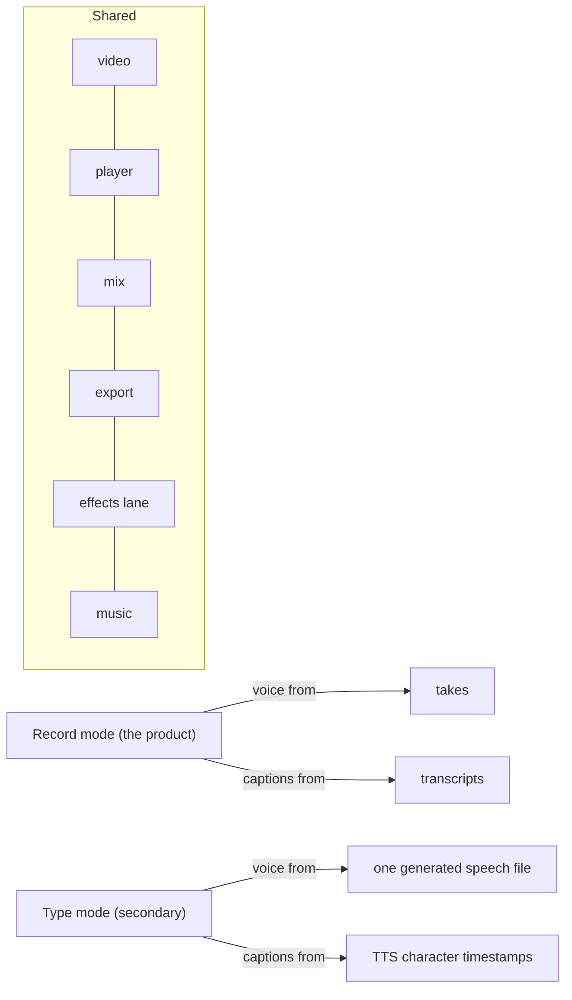

# Architecture

> **At a glance**
> - Two layers, one direction: **App** (SwiftUI, iOS 26) depends on **VoiceoverKit** (pure Swift, tested on macOS).
> - `Project` holds the edit and is deliberately dumb. `EditorModel` is the only orchestrator.
> - Views never mutate anything that changes what is heard; they call `EditorModel`.
> - Work runs in two slots, **compose** (cheap, restartable) and **job** (billed, never cancelled by accident).

## 1. Layers



| Layer | Owns | Must not contain |
|---|---|---|
| **VoiceoverKit** | ElevenLabs client and error model, timeline maths (overlap resolution, caption assembly, line breaking), shared value types (`Take`, `AudioSegment`, `Character`, `Voice`, `VoiceSettings`, `Caption`, `TimedWord`), Keychain | AVFoundation, UIKit, SwiftUI, file-system layout |
| **App** | State, files, media, UI. AVFoundation, Speech, Photos, PhotosUI | Business rules that could be tested without a device |

The kit builds in Swift 6 language mode and is tested with `swift test` on macOS, with a stub `HTTPTransport`
instead of the network. That is the reason the boundary is where it is: anything that needs a simulator to test
stays in the app.

The app has its own test target, `AppTests`, hosted in the app on the simulator. It covers what the review found
bugs in: `WorkRunner`'s two slots and deferred steps, the autosaver (including the save loop), `ProjectStore`,
`Project`'s file lifecycle, edits routed through `EditorModel`, the jobs (export and its retry, music, transcription)
against stub `EditorServices`, the key handling in `AppModel`, and that translations reach the built app.
AVFoundation itself (recording, composing, rendering) is not unit-tested.

## 2. Folders

```
App/
  App/           VoiceoverStudioApp (entry), AppModel (composition root), APIKeyStore, PreviewSupport
  Models/        Project (the edit), SoundEffect, BackgroundMusic, LiveRecording
  Persistence/   ProjectDocument (on-disk shape), ProjectStore, ProjectAutosaver, ProjectSummary, EditingMode
  Media/
    Composition/ VideoComposer, ComposedVideo, AudioClip + AudioKind, MixLevels
    Recording/   TakeRecorder, Waveform, AudioSession
    Speech/      Transcriber, RecordingLanguage
    Video/       FrameStrip, Thumbnail, PhotosSaver, PickedMovie, PlaybackEndWatcher
    ElevenLabs/  VoiceSwapper
  Features/
    Navigation/  AppRoute, EditorRoute, VoiceTarget
    Projects/    ProjectListView (root), ProjectRow, ProjectScreen (loads a project, owns its EditorModel)
    Editor/      EditorView (+Helpers), EditorModel (+Recording, +Effects, +Music, +Jobs), EditorServices, WorkRunner, EditPlayer, RecordingSession, TranscriptionQueue, Sections/
    Recording/   RecordingView (full-screen recorder), EffectSheet, MixPopover, Timeline/{TimelineStrip, SegmentView}
    Preview/     EditPreview, PreviewScreen, PreviewPlayer, CaptionOverlay, PlayerLayerView, AVPlayer+TimeUpdates
    Settings/    SettingsView
    Voices/      VoicePickerView
Packages/VoiceoverKit/Sources/VoiceoverKit/
  ElevenLabs/    ElevenLabsClient, ElevenLabsError, HTTPTransport, MultipartForm, Voice, Speech, VoiceSettings
  Timeline/      Take, AudioSegment, TakeResolver, Character
  Captions/      TimedWord, Caption, CaptionBuilder, CaptionAssembler
  Keychain/      KeychainStore
```

Conventions:

- One type per file.
- `X+Y.swift` is an extension of `X` grouping the `Y` concern. Members it needs are `internal`, not `private`,
  on purpose.

## 3. Dependencies and navigation



`AppModel` is the composition root. Everything it holds comes in through `init` with a live default, and it has
no side effects (the audio session is configured in the app's `init`). Views read it from the environment;
`ProjectScreen` asks it for an editor with `editor(for:)`, so no view assembles dependencies itself.

| Seam | Live | Replaced in |
|---|---|---|
| `APIKeyStoring` | Keychain (`APIKeyStore`) | tests, previews (`InMemoryKeyStore`) |
| `ProjectStore(root:)` | `Documents/Projects` | tests, previews (a temporary folder) |
| `HTTPTransport` | `URLSession` | package and app tests (stub responses) |
| `EditorServices` | AVFoundation, Photos, Speech | app tests (`EditorServices.stub`) |

> **Decision.** `EditorServices` is a struct of `@Sendable` closures, not a set of protocols.
> **Why.** Each test replaces one or two operations (fail the Photos save once, record the clips handed to the
> composer) and keeps the rest. A protocol per service would need a fake type per test.
> **Rejected.** A dependency-injection library. The app has one composition root and four seams.

**Navigation.** The root `NavigationStack` owns a `NavigationPath` of values. `AppRoute.project(id)` is pushed
from the list and resolved at the root; `EditorRoute.voice(target)` is pushed from inside a project and resolved
by `EditorView`, the only place that has the model the picker writes to. Every pushed screen is on the path, so
a screen can be opened from code (a new project, the debug hook) the same way a tap opens it.

Modal screens are one optional value per screen: `EditorView.Cover` (recorder or preview) for full-screen covers,
plus the Settings sheet. Two covers cannot be requested at once, and `EditPreview` is the one place a preview of
the edit is built.

## 4. Who owns what



| Object | Lifetime | Owns |
|---|---|---|
| `AppModel` | app | `ElevenLabsClient`, `ProjectStore`, API-key presence; sets the playback audio category at launch |
| `ProjectStore` | app | the `Documents/Projects` folder and the list of summaries |
| `Project` | while its editor is open | all edit state: video, characters, takes, transcripts, converted audio, effects, mix, trim, Type-mode result, export |
| `EditorModel` | while its editor is open | orchestration: player, composed edit, activity and failure, recorder, transcription tasks, autosaver, strip cache |
| `TakeRecorder` | per editor | `AVAudioRecorder`, live metering |
| `ProjectAutosaver` | per editor | observes `Project.document`, saves after 600 ms |
| `RecordingView`, `PreviewScreen` | while presented | nothing; they read the model and call it |

### The one rule for views

> **Decision.** Views do not mutate `Project` except for presentation-only fields: `activeCharacterID`, `mix`,
> `script`, `voice` in Type mode. Everything that changes what is heard or what the export covers (takes,
> characters and their voices, effects, trim, mode) goes through an `EditorModel` method.
> **Why.** The model must follow the mutation with `rebuildCaptions()`, `recompose()` or dropping the stale export.
> The first version let `CharactersSection` delete a character straight on the project: its takes and files went,
> the player kept an item pointing at them and the captions stayed.
> **Rejected.** Having `EditorModel` observe `project.segments` and react. Implicit, and it cannot know *which*
> follow-up (captions, recompose, export reset) the change needs.

`Project` mutates state, deletes files it no longer references, and knows nothing about AVFoundation, networking
or Observation beyond being `@Observable`.

## 5. A session, end to end



Every mutation of `Project` along the way is picked up by the autosaver and the manifest is rewritten
atomically (see [persistence.md](persistence.md)).

## 6. Activities, slots and the state machine



`EditorModel.activity` holds the current step. `run(_:slot:retry:operation:)` wraps each step so that an error
becomes a `Failure` with a recovery (open settings, retry, edit input, none) and **the retry repeats only that
step**.

### Two slots

| Slot | Runs | Cancellation | Why separate |
|---|---|---|---|
| **compose** | `recompose()` | A newer compose cancels an older one | Cheap and frequent; restarting is fine |
| **job** | swap, export, generate, effect, music, Photos save | Only the user's Cancel button | Spends credits or minutes; a cancelled swap is already billed |

Consequences:

- `isBusy` is true while a job runs. Edits that would change the composition (delete a take, switch mode, remove
  an effect) are disabled in the UI and ignored by the model.
- A `recompose()` requested during a job is deferred (`needsRecompose`) and runs when the job finishes.
- A job that needs the edit rebuilt at its end calls `compose(videoURL:)` directly. Calling `recompose()` would
  cancel the job's own slot.

> **Decision.** `Failure.retry` re-enters the public method with plain values
> (`{ [weak self] in self?.export() }`), never the operation closure.
> **Why.** A failure is stored on the model. A retry that captured the operation would capture `self` through it,
> and the editor would never deinit after its screen was popped.

## 7. Modes



`EditingMode.record` is the product; `.type` is the original script-to-speech flow kept as a secondary path. They
share the video, the player, the mix, the export, the effects lane and the background music.
