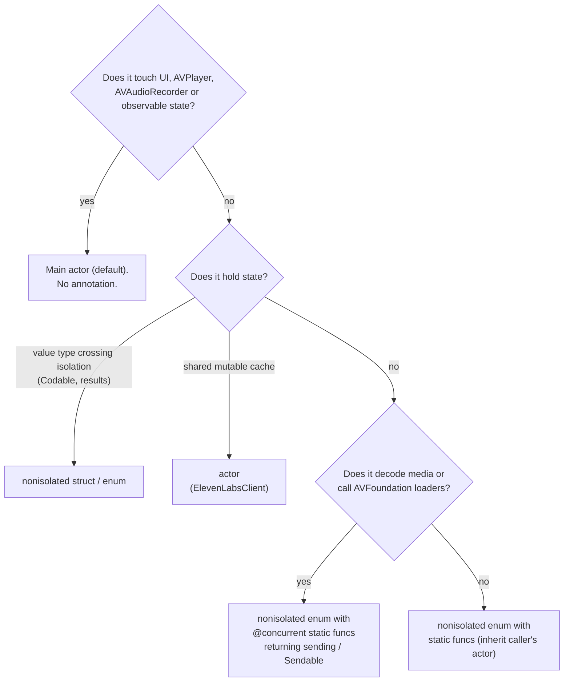
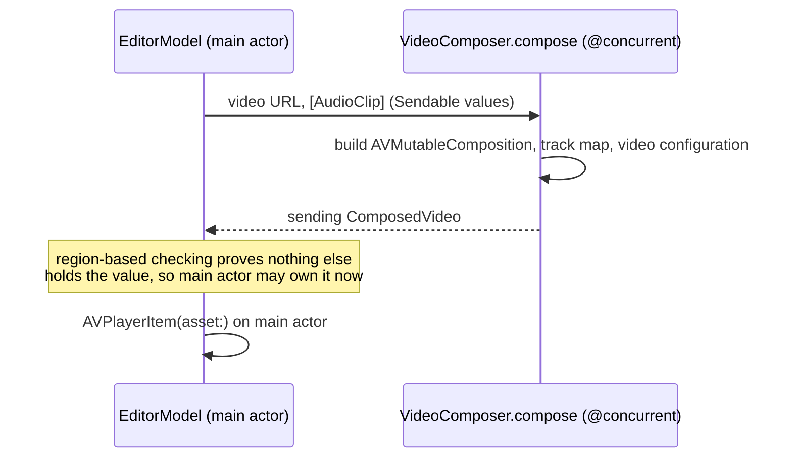
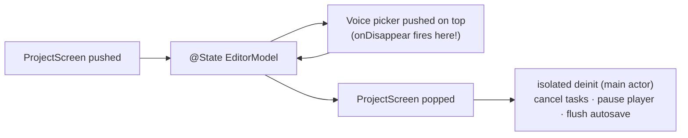

# Swift concurrency decisions

> **At a glance**
> - Strict concurrency, Swift 6 mode, `SWIFT_DEFAULT_ACTOR_ISOLATION: MainActor`, `SWIFT_APPROACHABLE_CONCURRENCY: YES`.
> - Default is **main actor**. Only three kinds of things leave it: `nonisolated` value types, stateless
>   `nonisolated` workers, and `@concurrent` media functions.
> - Results come back as `sending` values, never through `@unchecked Sendable` wrappers.
> - `EditorModel` lifetime is handled by `isolated deinit`, not `onDisappear`.

## 1. The decision tree

With approachable concurrency a `nonisolated async` function **inherits the caller's actor** (SE-0461). That is the
right default for small helpers and the wrong one for anything that decodes media. `@concurrent` is the opt-out.

## 2. The three answers

### Main actor: state and orchestration

`Project`, `EditorModel`, `TakeRecorder`, `ProjectStore`, `ProjectAutosaver`, every view. They mutate observable
state and talk to UIKit and AVKit objects that are main-actor bound. Nothing to annotate.

### `nonisolated` types

| Kind | Types | Why |
|---|---|---|
| Value types that cross isolation | `AudioClip`, `AudioKind`, `MixLevels`, `ComposedVideo`, `ProjectDocument`, `ProjectSummary`, `EditingMode`, `Waveform`, `APIKeyStore`, `PickedMovie` | A main-actor struct's `Codable` conformance cannot be used from a background decode; `ProjectStore.loadInBackground` hit exactly that |
| Stateless workers | `VideoComposer`, `VoiceSwapper`, `Transcriber`, `FrameStrip`, `Thumbnail`, `PhotosSaver` | `enum`s with static functions; there is no instance to protect |

> **Gotcha.** Default isolation is per declaration. An `extension` of a `nonisolated` type that holds
> `init(from:)` must say `nonisolated` again, or the conformance "crosses into main actor-isolated code".

### `@concurrent`: work that must leave the main actor

`VideoComposer.compose`, `FrameStrip.image`, `Waveform.load`, `Transcriber.words`, `Thumbnail.write`,
`EditorModel.write`. Marked `@concurrent`, which pins them to the cooperative pool regardless of who calls.

> **Decision.** `VideoComposer.compose` is `@concurrent` and returns `-> sending ComposedVideo`.
> **Why.** `AVMutableVideoComposition.videoComposition(withPropertiesOf:)` is an Objective-C async method and
> always hops to a background executor. Calling it from a main-actor `compose` *sent* the non-Sendable
> `AVMutableComposition` across an isolation boundary: "sending value of non-Sendable type … risks causing data
> races". Once `compose` is `@concurrent`, the composition never leaves the nonisolated context.
> **Rejected.** Wrapping the composition in an `@unchecked Sendable` box. It would have silenced the compiler
> without changing where the work ran.

## 3. How a value crosses back: `sending`

`ComposedVideo` is a non-Sendable struct. Returning it is allowed because the function is declared
`-> sending`: the value was created inside the function and nothing else references it.

### What must stay on the main actor even in media code

- `AVPlayerItem` is main-actor bound in the iOS 26 SDK. Constructing it inside `compose` does not compile;
  `EditorModel.compose` creates it on the main actor. That is cheap: loading happens asynchronously.
- `AVPlayer`, `AVPlayerLayer`, `AVAudioRecorder` live in main-actor types.

### Rules of thumb

1. Default to main actor; annotate only what provably needs to leave it.
2. Prefer `nonisolated` value types over `@unchecked Sendable` classes.
3. If a function decodes media, it is `@concurrent` and returns `sending` or `Sendable` values.
4. Never pass a main-actor object into a `@concurrent` function. Pass URLs, values and ids.
5. When the compiler complains about sending, move the work, not the annotation.

## 4. Actors

`ElevenLabsClient` is an `actor` because it owns the voice-list cache that several screens read. Its
`HTTPTransport` is a `Sendable` protocol so tests can inject a stub. The test stub records requests behind a lock
and is `@unchecked Sendable`, which is the honest way to make a mutable recorder thread-safe.

## 5. Closures that cross isolation

| Closure | Type | Rule |
|---|---|---|
| `VoiceSwapper.convert(... onOutcome:)` | `@MainActor @Sendable (Outcome) -> Void` | Results of parallel calls land on the main actor one by one, so `Project` updates as each take finishes |
| `EditorModel.run` operation | captures `[client, project]` explicitly where work runs off-actor | Avoid capturing `self` into a `@Sendable` context by accident |
| `Failure.retry` | `{ [weak self] in self?.method(values) }` | Must not capture the operation; see lifetimes below |

## 6. Lifetime: `isolated deinit` and the two task slots

> **Decision.** Teardown lives in `EditorModel`'s `isolated deinit` (SE-0371, Swift 6.2).
> **Why.** The first version flushed and stopped in `onDisappear`, which also fires when a child screen is pushed.
> That cancelled running exports and stopped autosave while the user was picking a voice.
> **Constraint.** Nothing on the model may point back at it, or deinit never runs. That is the reason for the
> `Failure.retry` rule above.

> **Decision.** `composeTask` and `jobTask` are separate.
> **Why.** One shared `work` task meant a cheap `recompose()` after a deleted take cancelled a running swap
> (already billed), and `addEffect` cancelled *itself* when it called `recompose()` at its end, so the waveform load
> that followed saw a cancelled task and quietly returned nothing.

## 7. Observation

- `@Observable` classes everywhere; no Combine.
- `ProjectAutosaver` uses `withObservationTracking` recursively: it reads `Project.document` (a computed snapshot
  that touches every persisted property), gets a one-shot `onChange`, hops to the main actor, schedules a debounced
  save and re-registers. "Save after any change" without listing properties.
- `TimelineStrip` reads `player.currentTime()` inside `TimelineView(.animation)`, so the strip is positioned per
  display frame from the player's clock rather than from a 10 Hz time observer.

## 8. Priorities and deferral

| Work | Priority / timing | Reason |
|---|---|---|
| Waveforms of a loaded project | `Task(priority: .utility)`, one file at a time in `waveformTask` | Decorations; must not compete with the player that just started; cancellable from deinit |
| Frame strip | `.utility`, requested 350 ms after the recorder appears | Lets the presentation animation have the main thread |
| Manifest decode | `Task.detached(priority: .userInitiated)` after a 300 ms sleep in `ProjectScreen` | Lets the push animation run first |
| Writing generated audio | `@concurrent EditorModel.write` | A few megabytes on the main actor was a visible hitch on the button |
