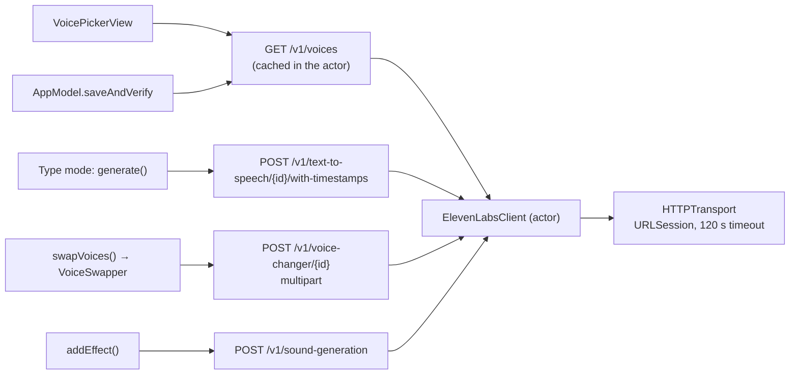
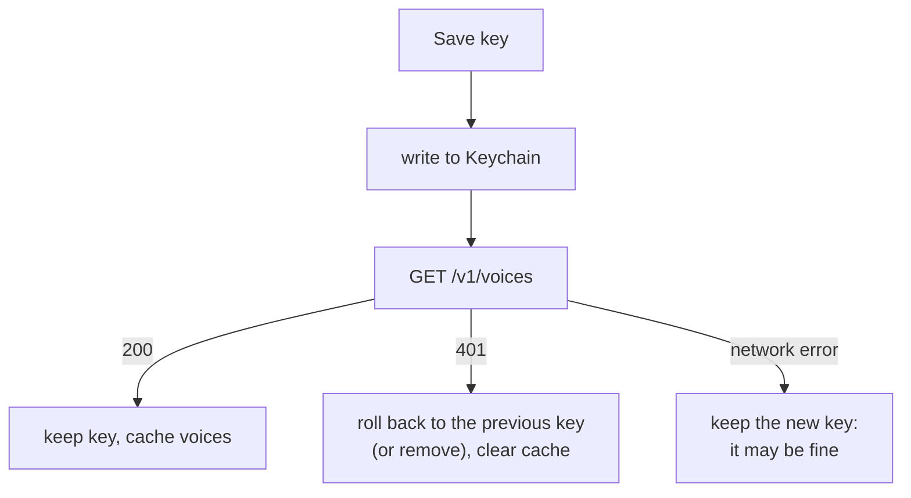
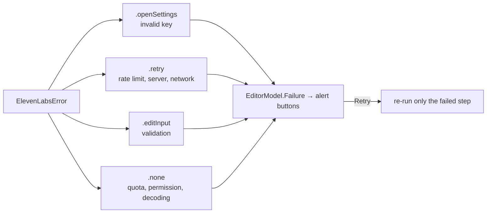

# ElevenLabs integration

> **At a glance**
> - Four endpoints, one actor (`ElevenLabsClient` in the kit), key read lazily from the Keychain.
> - Nothing is called until the user presses a button that says it will cost credits.
> - The key needs **four** permissions; a missing one is a 401 that looks like a bad key unless handled.
> - Every error carries a `Recovery` that becomes the alert's buttons.

## 1. Who calls what



| Call | Endpoint | Model / format |
|---|---|---|
| `voices(forceRefresh:)` | `GET /v1/voices` | cached |
| `speech(text:voiceID:modelID:settings:)` | `POST /v1/text-to-speech/{id}/with-timestamps` | `eleven_multilingual_v2`, returns MP3 + per-character times |
| `changeVoice(audio:fileName:mimeType:voiceID:modelID:settings:removeBackgroundNoise:)` | `POST /v1/voice-changer/{id}` | `eleven_multilingual_sts_v2`, multipart |
| `soundEffect(prompt:durationSeconds:)` | `POST /v1/sound-generation` | |

Output format is `mp3_44100_128` everywhere. The 120 s timeout exists because the voice changer uploads a whole
take and waits for the conversion.

## 2. Key handling



The key is read through a closure, so a key change needs no new client. Removing the key clears the voice cache.

### Permissions the key needs

| Permission | Used by |
|---|---|
| Text to Speech | Type mode |
| Speech to Speech (Voice Changer) | voice swap |
| Voices | picker, verification |
| Sound Effects | effects lane |

> **Decision.** HTTP 401 with `detail.status == "missing_permissions"` maps to
> `ElevenLabsError.missingPermission(message)` and shows the server's message, which names the permission.
> **Why.** A plain 401 or `invalid_api_key` is `.invalidAPIKey`. Treating both as "key rejected" cost a debugging
> session on a key that was valid but lacked Speech to Speech.

## 3. Error model



## 4. Voice settings

`VoiceSettings { stability, similarityBoost, style, speed, useSpeakerBoost }`, all optional, encoded with snake_case
keys.

| Preset | Values | Used for |
|---|---|---|
| `.narration` | stable | Type mode default |
| `.expressive` | stability 0.3, style 0.4 | voice conversion default, so the result follows the recording's delivery |

## 5. Credits

| Call | Billed by | What the UI does about it |
|---|---|---|
| TTS | characters of script | footer shows the count |
| Voice changer | audio length | Swap button shows the seconds it will send; only takes without a current conversion go; a changed voice invalidates only that character |
| Sound effects | generated seconds | the sheet says so; one request per effect, kept forever |

## 6. Timing after a swap

```
recording   |██████████████████|  4.00 s
converted   |████████████████████|  4.21 s   → conversionDrift = 0.21 s  (flagged above 0.15 s)
captions    timed from the recording
```

Speech-to-speech preserves pace closely but not exactly. The take is flagged in the list and the timeline when the
drift exceeds 150 ms, because captions are timed from the original recording.

## 7. Multipart

`MultipartForm` is a 40-line encoder. The test asserts the exact body layout, including the boundary terminator
and that the binary audio is embedded unchanged.
