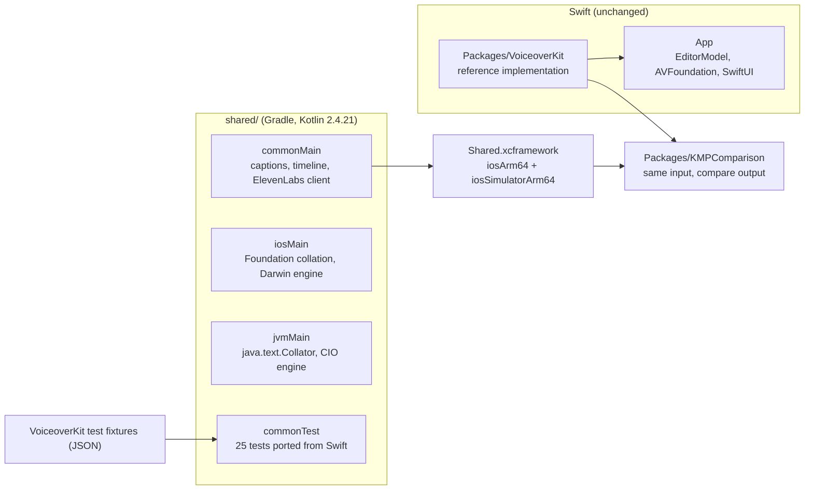

# Kotlin Multiplatform experiment

> **At a glance**
> - An additive experiment: the caption logic and a minimal ElevenLabs client were ported to Kotlin
>   (`shared/`, 630 lines) and run on the JVM and on iOS from one source set. The Swift package stays the
>   reference implementation, and the app does not link the Kotlin framework or need Gradle.
> - Verified two ways: the Swift tests were ported as the spec (25 Kotlin tests, green on the JVM and on the
>   iOS simulator), and a Swift test target feeds the same input to both implementations and compares the
>   output (8 tests, 500 generated transcripts and 200 generated take layouts, all equal).
> - One known difference: caption length is counted in code points in Kotlin and in grapheme clusters in
>   Swift, so emoji sequences and combining marks wrap earlier in Kotlin.
> - **Verdict: it does not pay off for this app.** There is no second platform, the shareable part is about
>   a sixth of the code and already the easiest part to maintain, and the price is a second toolchain, a
>   4 to 6 MB runtime and a worse API at the boundary. It would pay off the day an Android client is planned.



## How to run it

```bash
./gradlew :shared:allTests
```

```bash
Scripts/kmp-compare.sh
```

The first command runs the Kotlin tests on the JVM and on an iOS simulator. The second also builds
`Shared.xcframework` and runs the Swift comparison on the simulator. Both need JDK 17 or newer and nothing else;
the Gradle wrapper downloads Gradle, the Kotlin/Native compiler and the libraries on first use.
`Scripts/check.sh`, CI and the Xcode project are untouched.

| Tool | Version | Looked up |
|---|---|---|
| Gradle | 9.9.2 (wrapper, distribution checksum pinned) | services.gradle.org, 2026-11-20 |
| Kotlin Multiplatform | 2.4.21 | Maven Central |
| Ktor client | 3.6.1 | Maven Central |
| kotlinx.serialization | 1.13.0 | Maven Central |
| kotlinx.coroutines | 1.11.0 | Maven Central |

Versions live in `gradle/libs.versions.toml`.

## What was shared, and why those pieces

| Swift original | Kotlin port | Why it is a candidate |
|---|---|---|
| `Captions/CaptionBuilder.swift` | `captions/CaptionBuilder.kt` | Pure functions over strings and doubles |
| `Captions/CaptionAssembler.swift` | `captions/CaptionAssembler.kt` | Pure; the rule that decides what the viewer reads |
| `Timeline/TakeResolver.swift` | `timeline/TakeResolver.kt` | Pure interval arithmetic; the rule that decides what the viewer hears |
| `Caption`, `TimedWord`, `Take`, `AudioSegment` | data classes beside them | Plain values |
| `ElevenLabsClient` (voices, speech with timestamps) | `elevenlabs/ElevenLabsClient.kt` on Ktor | HTTP and JSON, the classic shared layer |
| `ElevenLabsError.from(status:body:)` | `ElevenLabsError.from` | A decision table that must not differ between platforms |
| `Voice`, `VoiceSettings`, `CharacterAlignment`, `Speech` | `@Serializable` classes | Wire format |

These are the rules an Android client would have to reproduce exactly: where a caption breaks, which take
wins an overlap, which HTTP answer means "open Settings". They have no platform dependency and already had
tests, so the port could be checked against a spec instead of by eye.

Two things were needed that common Kotlin does not have, and both show the mechanism the experiment was
meant to exercise:

- **Collation.** The voice list is sorted with `localizedCaseInsensitiveCompare`. Common Kotlin has no
  locale-aware comparison, so `compareLocalizedCaseInsensitive` is an `expect` function with an `actual` on
  Foundation for iOS and on `java.text.Collator` for the JVM.
- **Whitespace.** `Character.isWhitespace` in Swift follows the Unicode `White_Space` property;
  `Char.isWhitespace()` in Kotlin is a different set (it includes U+001C to U+001F and omits U+0085). The
  port spells the set out so word boundaries are the same on every target. The comparison test includes
  U+0085, U+00A0 and U+2003 for this reason.

The test fixtures are not copied. A small Gradle task turns
`Packages/VoiceoverKit/Tests/VoiceoverKitTests/Fixtures/*.json` into Kotlin string constants at build time,
because `commonTest` has no portable way to load a resource file.

## What stayed in Swift, and why

| Left in Swift | Reason |
|---|---|
| `EditorModel`, `EditorServices`, all SwiftUI | UI and state are per platform by design; `EditorServices` is not rewired |
| AVFoundation composition, export, caption rendering | No common API; this is most of the app's real work |
| Speech recognition, Foundation Models (`Director/`) | Apple-only frameworks |
| `KeychainStore` | Platform secret storage; an `expect`/`actual` at best |
| Voice changer (multipart upload), sound effects, music | Outside the task's scope; they are more of the same client code and would port the same way |
| `Character`, Codable manifest types | Tied to the Swift persistence layer |
| Localised error messages | They live in the string catalog (en, ru, uk). Kotlin errors carry English text only, so the app would still map each case to its own string |

## Interop friction actually hit

Everything below was observed in this repo with Xcode 27.2 and the Objective-C export that an XCFramework
uses. Swift export and SKIE, which target several of these points, were not tried.

### Suspend functions and async/await

`suspend fun voices(forceRefresh: Boolean = false)` appears in Swift as
`voices(forceRefresh:) async throws`, and `try await client.voices(forceRefresh: false)` works, including
from a non-main thread and from a `@MainActor` class. What is lost:

- **Cancellation does not cross.** Cancelling the Swift `Task` does not cancel the coroutine; the request
  runs to completion. The Swift client turns `URLError.cancelled` into `CancellationError`, and the app relies
  on that when the user leaves a screen. Getting it back needs a hand-written wrapper per call or SKIE.
- **`@Throws` is mandatory.** Without `@Throws(ElevenLabsError::class, CancellationException::class)` an
  exception thrown from Kotlin terminates the process instead of reaching `catch`.
- **Errors arrive untyped.** `catch` receives an `NSError`; the Kotlin exception is in
  `userInfo["KotlinException"]` and has to be cast (`SuspendBridgingTests` shows it). Swift's typed
  `throws(ElevenLabsError)` is not available.
- **Default arguments disappear.** Every call names every parameter:
  `captions(words:maxCharacters:maxDuration:track:firstId:)`, `voices(forceRefresh: false)`.

### Sealed classes and enums

- A Kotlin `sealed class` becomes an open Objective-C class hierarchy. `switch error { case is
  ElevenLabsError.MissingApiKey: … }` is rejected with "switch must be exhaustive" until a `default` is added,
  so adding a case in Kotlin no longer breaks the Swift build where it should.
- A Kotlin `enum class` becomes a class with static instances, not a Swift enum. `.openSettings` reads
  nicely in an `==`, but a `switch` over `Recovery` also needs `default`.
- Exceptions should not be singletons (they carry a stack trace), so the error cases are classes with a
  hand-written `equals` instead of `data object`. The Swift enum gets `Equatable` for free.
- `object CaptionBuilder` is reached as `CaptionBuilder.shared`, a constant as
  `TakeResolver.shared.MINIMUM_DURATION`.

### Types at the boundary

- `Int` is `Int32`, `List<Double>` is `[KotlinDouble]` (each element boxed by hand), `ByteArray` is
  `KotlinByteArray`, not `Data`.
- `kotlin.uuid.Uuid` and Foundation `UUID` are unrelated; the bridge is the string form. `Uuid` is still an
  opt-in API. There is no common `URL`, so `Take.recording` and `Voice.previewUrl` are strings.
- Kotlin data classes are reference types without `Equatable` or `Hashable` semantics Swift can rely on in
  generics, and without `Codable`.
- Both modules define `Caption`, `TimedWord`, `Take`…, so every use is module-qualified. In an app that
  adopted the framework the Swift types would go away, but the conversions in
  `Packages/KMPComparison/Tests/KMPComparisonTests/Bridging.swift` would not: they are what a boundary to
  AVFoundation code looks like.
- The header leaks dependencies. The public constructor takes Ktor's `HttpClient`, and that pulls Ktor,
  coroutines and serialization types into the generated header: 8220 lines and 124 classes, of which 43 are
  ours. Making that constructor `internal` would shrink it.

### `Sendable` under Swift 6 strict concurrency

Kotlin classes are exported without `Sendable`. Measured with a probe file compiled in Swift 6 mode:

| Code | Result |
|---|---|
| `try await client.voices(...)` inside a `@MainActor` class that owns the client | compiles |
| `struct Services: Sendable { let client: Shared.ElevenLabsClient }` | error: stored property has non-Sendable type |
| `Task.detached { try await client.voices(...) }` with a captured client | error: sending closure risks data races |

The app's DI seam is `EditorServices`, a `Sendable` struct of `@Sendable` closures called from several
isolation domains. A Kotlin client could not be stored there without `@preconcurrency import Shared` or an
`@unchecked Sendable` wrapper. The Kotlin client is in fact safe to share (its cache is behind a `Mutex`),
but the compiler cannot know, so the guarantee `docs/concurrency.md` describes would become a promise.

### Behaviour that cannot be made identical

- **Grapheme clusters.** `String.count` in Swift counts user-perceived characters. The Kotlin common
  standard library has no grapheme segmentation, so the port counts code points. Latin, Cyrillic and CJK
  text gives identical captions; an emoji sequence or a combining mark counts as more than one in Kotlin.
  `graphemeClustersAreCountedDifferently` records this as a known issue instead of hiding it.
- **Network error detail.** Swift keeps `URLError.Code` (`.notConnectedToInternet`, `.timedOut`). Ktor's
  engines throw different exception types per platform; the common code can only catch `IOException`, so
  `ElevenLabsError.Network` carries the cause and nothing more specific.
- **Lenient numbers.** `kotlinx.serialization` accepts a quoted number where a `Double` is expected;
  `JSONDecoder` does not. Not reachable with the real API, but it is a difference.

### Binary size

Release build, `iosArm64`, Kotlin 2.4.21:

| Artifact | Size |
|---|---|
| Static `Shared.framework` binary (what the XCFramework ships, before the app's linker strips it) | 13.5 MB |
| The same code linked as a dynamic framework | 6.1 MB |
| The dynamic framework after `strip -x` | 4.5 MB |
| VoiceoverKit release object files, the whole package including parts not ported | 1.4 MB |

Most of the Kotlin figure is the Kotlin/Native runtime, the garbage collector, Ktor, coroutines and
serialization, not the 630 lines. The cost in a shipped app was not measured because the app does not link
the framework; 4 to 6 MB is the realistic range.

### Build time and toolchain

Measured on this machine (Apple silicon):

| Step | Time |
|---|---|
| First `:shared:allTests`, including the Kotlin/Native download | 1 min 49 s |
| `:shared:jvmTest` after a change | 4 s |
| Release XCFramework (two slices) from scratch | 1 min 27 s |
| Release XCFramework after a one-line change | 1 min 22 s |
| Clean release build of the whole Swift package | 12 s |
| Swift comparison tests, including the simulator launch | 1 min |

The fast loop exists, but only on the JVM. Anything that must be seen from Swift costs over a minute per
change, because the native link is not incremental. The toolchain adds 1.6 GB in `~/.konan` and a Gradle
distribution of 147 MB, and CI would need a JDK and a cache for both. Linking the simulator test binary
printed 322 `warning: could not open …stdlib-per-file-cache…` lines from the linker; the tests pass and the
cause was not investigated.

## Verdict

For this app, no.

- **Nothing consumes the second target.** KMP earns its cost by removing a second implementation. Here the
  JVM target exists only to run tests.
- **The shareable slice is small and already cheap.** About 1100 of roughly 7000 Swift lines are platform-free,
  and they are the best-tested, least-changing lines in the project. The hard parts (AVFoundation
  composition, recording, speech, export) cannot be shared.
- **The boundary gets worse, not better.** Typed errors, exhaustive switches, `Sendable` checking,
  cancellation and value semantics are things the Swift code leans on daily, and each one is weakened at the
  framework edge or needs wrapper code.
- **Two toolchains for one developer.** Gradle, Kotlin/Native and a JDK join Xcode, XcodeGen and SwiftLint;
  the edit-to-device loop for shared code goes from seconds to over a minute.

What would change the answer: a planned Android client. Then the caption and overlap rules and the error
table are exactly what should exist once, the ports here are a working start, and the friction above is the
known price. In that case the next steps would be SKIE or Swift export for the boundary, an `internal` HTTP
client constructor, a grapheme-aware length function behind `expect`/`actual`, and a CI job for
`Scripts/kmp-compare.sh`.

As a demonstration it does its job: one source set compiled to two platforms, `expect`/`actual` where the
platforms differ, coroutines bridged to async/await, and a port held to the original's tests rather than to
a visual check.

## Not verified

- No request was sent to the real ElevenLabs API from the Kotlin client. The Ktor Darwin engine is linked
  into the framework, but only `MockEngine` and the missing-key path were exercised.
- The `iosArm64` slice was built, not run on a device.
- The app was never linked against the framework, so its effect on app size, launch time and App Store
  processing is an estimate.
- CI does not run any of this.
