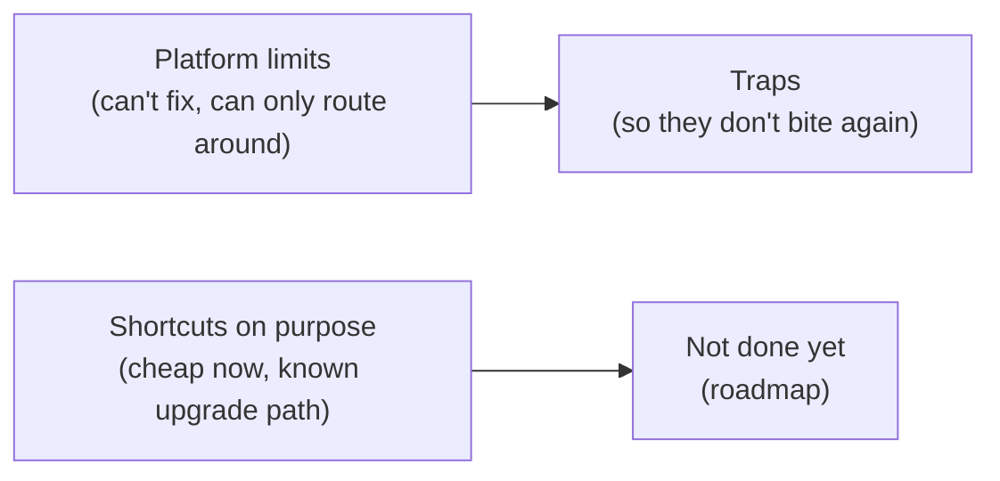

# Known issues, shortcuts and debt

> **At a glance**
> - Four groups: platform limits we cannot fix, shortcuts taken on purpose, things not done yet, and a list of
>   traps that already bit us once.
> - Each item says **why it is still there**. Items the review of 2026-11-03 fixed are gone from this file;
>   see [review-2026-11-03.md](review-2026-11-03.md).

## 1. Platform limits

| Limit | Effect | What the app does |
|---|---|---|
| Simulator microphone | recordings silent on a Mac whose default input is an aggregate device | the live level trace makes it obvious; test on device |
| Simulator video compositor | composited frames never reach `AVPlayerLayer` (`IQ-CA -19230`) | preview avoids the compositor; export still uses it, verify on device |
| On-device transcription languages | `SpeechTranscriber` covers English and a handful of others | ru, uk fall back to `SFSpeechRecognizer` (server, ~1 min cap); offline it fails |
| AVKit scrubber in Preview | shows the full length even when the export range is trimmed | playback is confined with `forwardPlaybackEndTime` |
| Debug builds | noticeably slower (no optimisation, concurrency checks) | judge animation smoothness in Release |

## 2. Shortcuts taken on purpose

| Shortcut | Why it is fine for now | Upgrade path |
|---|---|---|
| `Project` deletes files itself | manifest and folder stay in step within one mutation | a `ProjectFiles` helper |
| `ProjectStore` reads and writes JSON on the main actor except `loadInBackground` | manifests are tiny | move writes off-main when a project has hundreds of takes |
| Autosave 600 ms after the last change and on deinit | a crash inside the window loses one change | none planned |
| Debug hook `VOICEOVER_DEBUG_VIDEO` in `EditorView+Helpers` | behind `#if DEBUG` | none |
| `Scripts/check.sh` defaults to the `iPhone 17` simulator | one dev machine; `CHECK_DESTINATION` overrides it | none |
| App tests wait for unstructured tasks by polling (`eventually`) | the runner and autosaver start their own `Task`s; nothing to await | inject a clock or expose the tasks if the suite gets slow |
| Translations live in `Scripts/translations.py`, not edited in Xcode | one reviewed table, regenerated catalogs, `check.sh` fails on a gap | edit the catalogs in Xcode once a translator is involved |
| Transcription errors surface as an alert with Retry | works | a quieter inline state per take |
| Edits are **disabled** while a job runs (`isBusy`) rather than queued | simpler; a swap takes seconds | queue if jobs get long |
| `Waveform` and `FrameStrip` recomputed per open | utility priority, barely visible | cache on disk |
| The microphone (`RecordingSession`) and the frame strip are not behind `EditorServices` | they need real hardware or real video to mean anything | a `Recorder` protocol if recording logic grows |
| Root path is a `NavigationPath`, not a `Codable` array | two route types (app and editor); nothing restores a path yet | encode it with `NavigationPath.CodableRepresentation` for state restoration |

## 3. Not done yet

**Correctness and polish**

- `project.pbxproj` is committed next to `project.yml`. With xcodegen the usual choice is one or the other; both
  means they drift whenever someone forgets `xcodegen generate`.
- App tests run the editor's jobs against stub `EditorServices`; AVFoundation itself (recording, composing,
  rendering, recognising speech) is still checked by hand on a device.
- Project names and the default character name are stored in the language the project was created in;
  switching the device language does not rename them.

**Features**

- Dragging takes and effects along their lanes; trimming silence at take edges.
- Hearing other characters' takes while recording a reply (needs echo cancellation or headphones).
- Export settings (codec, resolution); today it is H.264 MP4 at source size via `HighestQuality`.
- Filler-word removal via Foundation Models using word timings.
- Streaming TTS.
- Type mode has no sound effects of its own anymore; effects are a project-level lane used by both modes.

## 4. Traps that already bit us

| # | Trap | Rule |
|---|---|---|
| 1 | `analyzeSequence` + `finalizeAndFinish` never ends the results stream | use `start(inputAudioFile:finishAfterFile: true)` |
| 2 | Speech model install fails with "not subscribed" | `AssetInventory.reserve(locale:)` first |
| 3 | `Configuration(for: composition)` ignores `preferredTransform` | build the video configuration by hand; half-black exports otherwise |
| 4 | Default audio session obeys the silent switch | set the category at launch, but **don't** `setActive(true)` there: it silences the user's music |
| 5 | `onDisappear` fires when a child is pushed | tear down in `isolated deinit` |
| 6 | A missing key permission looks like a rejected key | handle `missing_permissions` separately |
| 7 | A `;` after a failing build still runs the commit | use a script with `set -e` (`Scripts/check.sh`) |
| 8 | The save wrote `updatedAt` back into the tracked snapshot | nothing the autosaver tracks may be written by the save itself; it looped every 600 ms |
| 9 | One task slot for everything | a cheap step cancels an expensive one, and a step that re-enters `run` cancels itself; keep compose and jobs apart, call `compose` directly from a job |
| 10 | A retry closure stored on the model captured the operation | it captured `self` and the model never deinited; retry with values only |
| 11 | `Text(name ?? "Voice")` and helpers taking `String` | the fallback is a `String`, so it is neither localised nor extracted; wrap it in `String(localized:)` |
| 12 | A wrapper like `localized(_ key:)` around `String(localized:bundle:)` | the compiler extracts keys only from the direct call; `strings.sh` would drop them as stale |
| 13 | `Bundle.module` inside the package's test target | names the tests' bundle, not the package's; use `PackageResources.bundle` |
