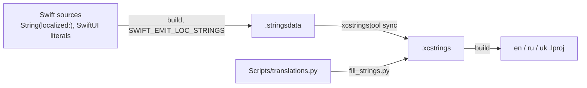

# Localization

> **At a glance**
> - English is the source language; Russian and Ukrainian are complete. Three catalogs:
>   `App/Resources/Localizable.xcstrings`, `App/Resources/InfoPlist.xcstrings` (permission prompts) and
>   `Packages/VoiceoverKit/Sources/VoiceoverKit/Resources/Localizable.xcstrings` (ElevenLabs errors).
> - The catalogs are generated. Translations live in `Scripts/translations.py`; `Scripts/strings.sh` writes them in.
> - `Scripts/check.sh` fails when a string has no translation, and `AppTests/LocalizationTests` checks that the
>   built app actually ships them, plural forms included.

## Adding or changing a string

1. Write it in English in code. In SwiftUI a literal passed to `Text`, `Button`, `Label` etc. is already a key.
   Anywhere the value is a `String` (a computed title, an error message, a `??` fallback) use
   `String(localized: "…")`; in the package add `bundle: .module`.
2. Run `Scripts/strings.sh`. It builds, syncs the catalogs and lists keys that have no translation.
3. Add the key to `APP` or `KIT` in `Scripts/translations.py` as `(ru, uk)`, run `Scripts/strings.sh` again.

## Plurals

A key with a count gets a dict of CLDR forms per language instead of a string. Russian and Ukrainian need
`one`, `few`, `many` and `other` (1 дубль, 3 дубля, 5 дублей, 21 дубль); English plural forms are in
`EN_PLURALS` in `fill_strings.py`. Plural keys today: `%lld takes`, and the credit hint in Type mode.

## Not translated

Codes and names (`xi-api-key`, `REC`, `Voiceover Studio`) are marked `None`, which writes
`shouldTranslate: false`. Messages that come from ElevenLabs' own error body are shown as ElevenLabs sent them.
Projects and characters keep the name they got when created; that is data, not interface.
