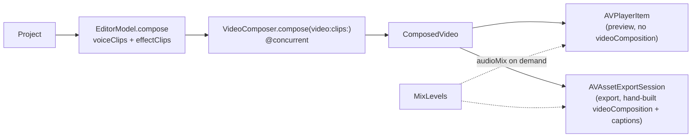
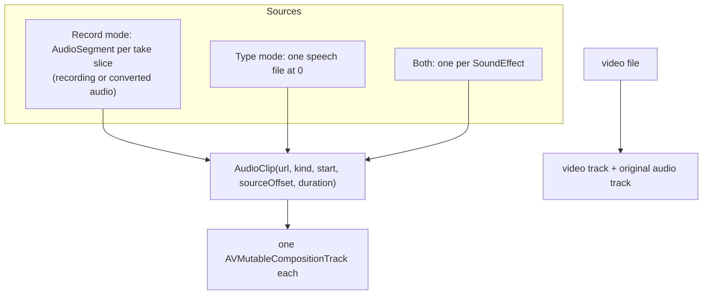
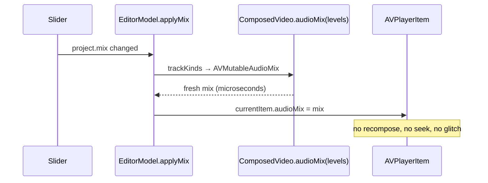
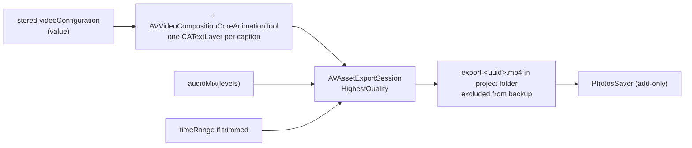
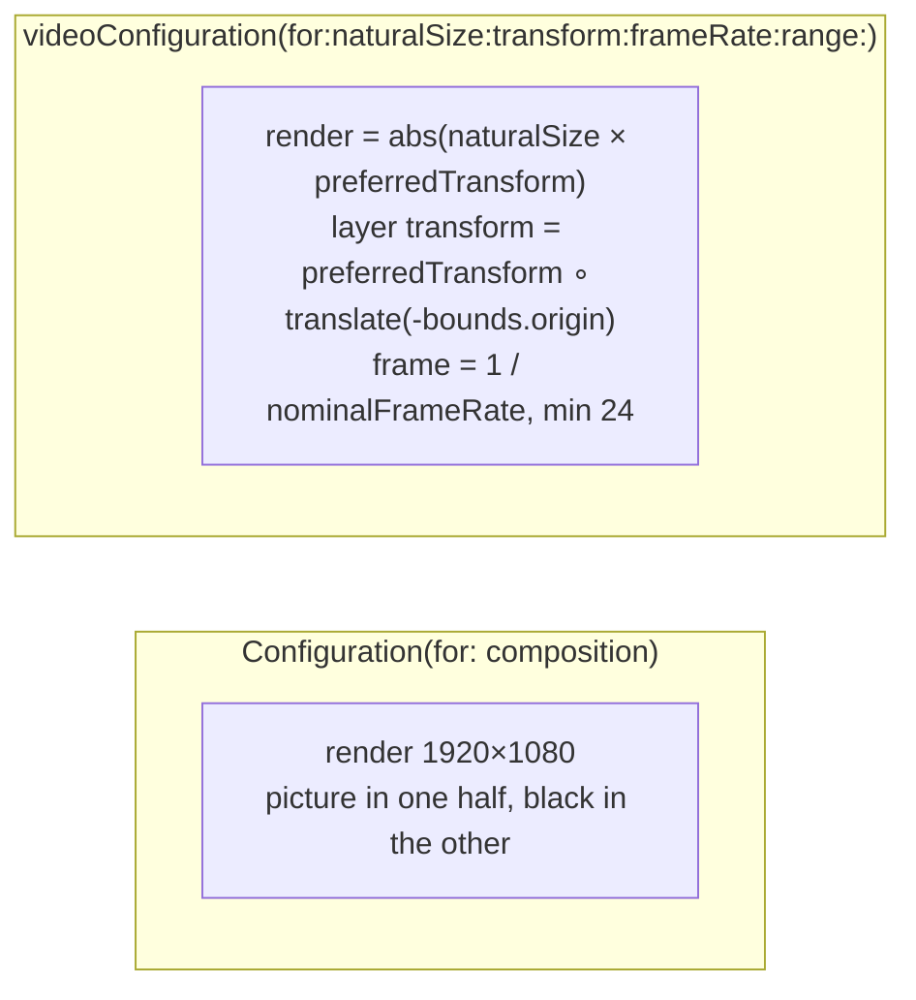
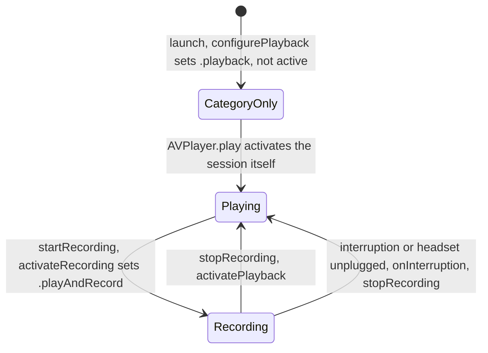
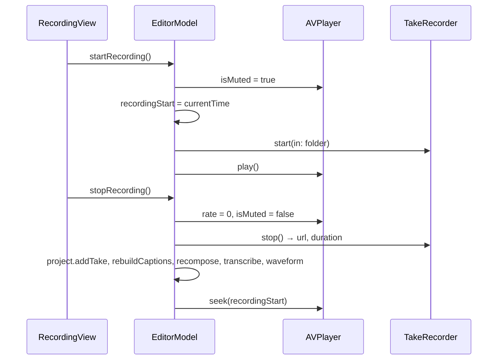

# Media pipeline

> **At a glance**
> - One `AVMutableComposition` feeds both the preview and the export. One audio track **per clip**.
> - Volume is never baked in: an `AVAudioMix` is rebuilt from the track map on demand.
> - The preview has **no video composition**; the export builds one **by hand** because the system one breaks
>   rotated phone footage.
> - Captions come from one `[Caption]` array and are rendered twice: SwiftUI overlay and `CATextLayer`.

Code: `App/Media/Composition`, `App/Media/Recording/AudioSession.swift`, `App/Features/Preview`.

## 1. One edit, two consumers

`ComposedVideo` holds:

| Field | Type | Used by |
|---|---|---|
| `composition` | `AVMutableComposition` | both, through the immutable `asset` copy |
| `trackKinds` | `[CMPersistentTrackID: AudioKind]` | `audioMix(_:)` |
| `videoConfiguration` | `AVVideoComposition.Configuration` (a value) | export only |

Both consumers receive `ComposedVideo.asset`, an immutable copy. AVFoundation asks for an immutable asset under a
running player or export, and track ids survive the copy so the mix parameters still match.

## 2. Clips and tracks

Rules in the composer:

- A clip that would start past the video's end, or whose file has no audio track, is skipped silently.
- Audio past the end of the video is trimmed to it.
- Converted audio keeps the take's timing, so the same `sourceOffset` and `duration` apply. When it drifts, see
  *Timing after a swap* in [elevenlabs.md](elevenlabs.md).

> **Decision.** One track per clip rather than one track per character.
> **Why.** Takes of different characters may overlap, and the effects lane plays under speech. Separate tracks also
> make the per-kind mix trivial.

## 3. The live mix

| Kind | Default level | Note |
|---|---|---|
| original | 0.25 | ducked under speech; **1.0** in the preview when there are no voice or effect tracks, so a freshly picked video sounds normal (`EditorModel.previewLevels`) |
| voice | 1.0 | |
| effect | 0.8 | |

The export gets `audioMix(levels)` with the project's values as set; the preview exception does not apply.

## 4. Preview without a video composition

> **Decision.** The preview `AVPlayerItem` has **no** `videoComposition`.
> **Why.**
> 1. `AVPlayer` applies the track's `preferredTransform` itself, so phone footage is upright.
> 2. Captions are a SwiftUI overlay driven by player time, not burned pixels.
> 3. In the iOS Simulator, frames from the video compositor never reach `AVPlayerLayer`: the log shows
>    `IQ-CA signalled err=-19230` and the picture is black. Headless playback and `AVAssetReader` work; only the
>    display path fails.
> **Bonus.** It is also the cheaper path on device.

The compositor is used only by the export, where it is needed for the caption layers.

## 5. Export

Caption layers: `opacity 0` plus a `CABasicAnimation` from `AVCoreAnimationBeginTimeAtZero + start` lasting
`end - start`. Layers for `track > 0` are offset upwards by one line so simultaneous speakers stack. Caption times
are composition times, so trimming shifts nothing.

### Why the video composition is built by hand

> **Decision.** `VideoComposer.videoConfiguration` builds the render size, the single instruction and the single
> layer instruction itself.
> **Why.** `AVVideoComposition.Configuration(for:)` **ignores the composition track's `preferredTransform`**. A
> portrait iPhone clip (stored 1920×1080, rotated 90°) came out with 44 % of the frame black. Reproduced with a
> synthetic rotated clip.
> **Verified.** Full frame on rotated, unrotated and HLG HDR sources.

The composition track still gets `preferredTransform`, because the preview, which has no video composition,
relies on it.

## 6. Captions: one source, two renderers

| | Preview | Export |
|---|---|---|
| Renderer | `CaptionOverlay` (SwiftUI `Text`) | `CATextLayer` per caption |
| Timing | `AVPlayer.timeUpdates(every:)`, filter `start ≤ t < end` | opacity animation on the composition timeline |
| Stacking | `VStack` sorted by `track` | y offset = `track × line height` |
| Style | title3 bold, white, shadow | system bold, 5.5 % of min(width, height) as `CTFont`, white, shadow |

Both read `EditorModel.captions`, rebuilt by `CaptionAssembler` (Record mode) or taken from the TTS alignment
(Type mode).

## 7. Audio session

> **Decision.** Set the category at launch, but do not activate the session.
> **Why.** The system default category obeys the silent switch, which made a relaunched app play the edit without
> sound. But `setActive(true)` at launch stops the user's music the moment the project list appears; AVPlayer
> activates the session itself when it plays.

While a take runs, `TakeRecorder` observes the session. An interruption (call, Siri, alarm) or a route change with
`.oldDeviceUnavailable` calls `onInterruption`, wired by `EditorModel` to `stopRecording()`, so what was recorded
becomes a take instead of leaving REC over a recorder the system already stopped. `RecordingView` does the same
when the scene goes to the background; there is no background audio mode.

## 8. Recording while the video plays

The player is muted so the microphone does not pick up the soundtrack. Hearing other characters' earlier takes
while recording a reply is on the roadmap; it needs echo cancellation or headphones.

## 9. Frame strip and thumbnails

> **Decision.** `FrameStrip.image` returns **one** `CGImage` for the whole strip (one frame per second,
> aspect-filled into cells).
> **Why.** One image moving at display rate is free. Forty `Image` views re-diffed every frame were not.

The strip is cached on `EditorModel` for the video's lifetime and generated at utility priority after the
recorder's presentation animation. `Thumbnail.write` saves a 360 px JPEG at t = 1 s for the project list.
