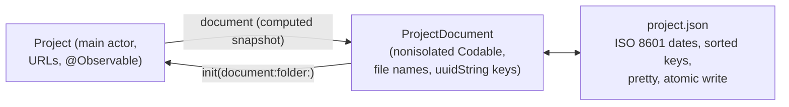
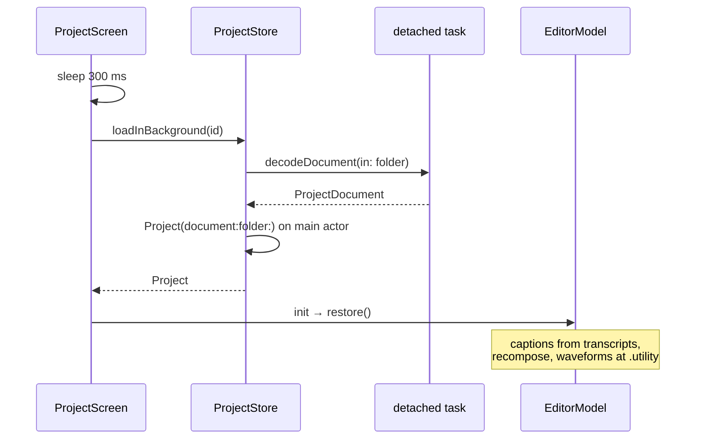
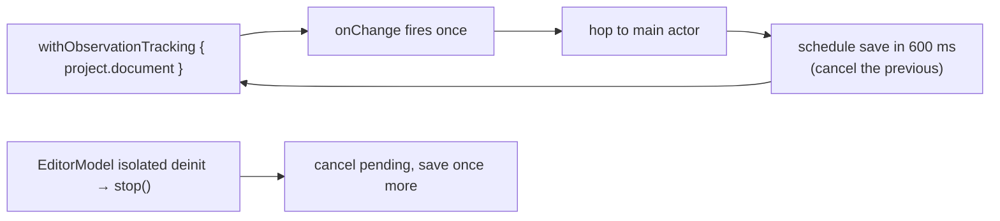

# Persistence

> **At a glance**
> - One folder per project under `Documents/Projects/<uuid>/`, a `project.json` manifest, media next to it.
> - Files are referenced **by name**; the container path changes between launches.
> - Autosave is `withObservationTracking` over one computed snapshot, debounced 600 ms, flushed in deinit.
> - `Project` deletes files in the same mutation that drops the reference, so folder and manifest stay in step.

## 1. Layout

```
Documents/Projects/<project-uuid>/
  project.json          manifest (ProjectDocument)
  thumbnail.jpg         poster frame for the list            ← excluded from backup
  video-<uuid>.mov      the picked video, moved here
  take-<uuid>.m4a       recordings
  swapped-<takeid>.mp3  converted voice per take
  effect-<uuid>.mp3     generated sounds
  speech-<uuid>.mp3     Type-mode generated speech
  export-<uuid>.mp4     the last export                      ← excluded from backup
```

A project is self-contained: copying the folder is a backup; deleting it removes everything.

> **Decision.** Folders + JSON, not SwiftData.
> **Why.** The heavy data is media files either way; the manifest is a few kilobytes of plain values with ids.
> A readable manifest is debuggable with `cat` and testable without a model container. `Codable` structs are
> trivial under Swift 6 strict concurrency; `@Model` classes are still fiddly.

## 2. Manifest (`ProjectDocument`)



| Stored | Not stored |
|---|---|
| title, dates, video file + duration, mode, characters, active character, takes, sequence counter, transcripts, converted audio + drift, effects, mix, trim, Type-mode script/voice/speech/captions, export file | waveforms (recomputed), frame strip (recomputed), player state |

Versioning rules:

- `version` is `ProjectDocument.currentVersion` (now 1).
- In the hand-written `init(from:)` **every field except `id`, `title` and the dates is `decodeIfPresent` with a
  default**. A new field is optional or defaulted and needs no bump.
- Only a change that cannot be expressed that way bumps the version and gets a migration branch.
- A manifest that fails to decode is shown by `ProjectStore.refresh()` as an "Unreadable project" row with Delete,
  not skipped. Skipping looks like data loss to the user.

## 3. Loading



Missing files degrade gracefully: a clip whose file is gone is skipped by the composer.

## 4. Autosave (`ProjectAutosaver`)



There is no Save button anywhere.

> **Decision.** `ProjectStore.save` never writes back into the project; `updatedAt` on `Project` is a `let`, and
> the store stamps the time into the manifest only.
> **Why.** The first version set `project.updatedAt` after each write. `updatedAt` is part of `document`, so the save
> counted as a change and the manifest was rewritten every 600 ms for as long as the editor was open. The review
> reproduced it in isolation: one mutation, 18 saves in 2 seconds at a 100 ms debounce.

## 5. Invalidation: where files get deleted

| Event | Dropped |
|---|---|
| Replace video | takes, converted audio, effects, transcripts, drift, waveforms, Type result, export, trim |
| Delete take | its recording, converted audio, transcript, drift, waveform |
| Change a character's voice or settings | converted audio + drift of that character's takes only |
| Delete character | its takes, as above |
| Delete effect | its file and waveform |
| Any recompose (new take, effect, trim, mode) | the current export file; `savedToPhotos` resets |
| Export again | the previous export file |

`Project` performs the deletions itself in the same mutation, so the manifest and the folder never disagree for
longer than the autosave delay.

## 6. Store and list

| Method | Does |
|---|---|
| `refresh()` | reads every manifest into `ProjectSummary` (title, date, duration, take count, exported flag, thumbnail presence) |
| `create()` | makes the folder and writes a first manifest, so an empty project is already valid |
| `load` / `loadInBackground` | decode and build a `Project` |
| `save` | atomic write; updates the summary in place so the list reorders without re-reading |
| `rename`, `delete` | title only / remove the folder |
