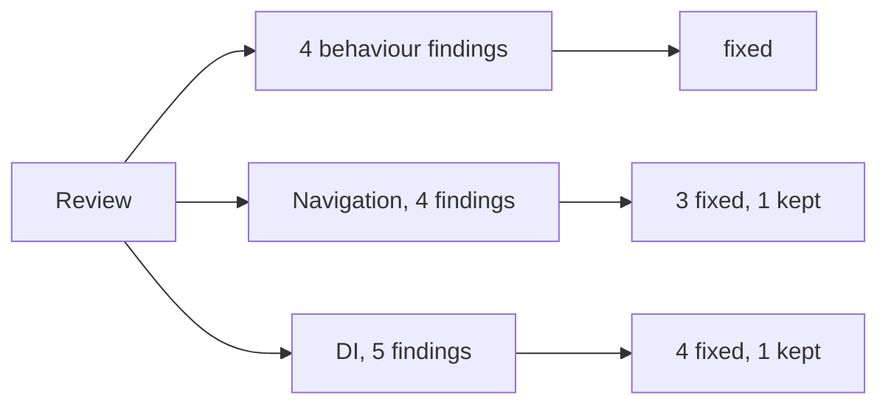

# Architecture review, 2026-11-18

> **At a glance**
> - Scope: the whole app before it goes public, with a closer look at navigation and dependency injection, and
>   the two features added since the last review (background music, auto-stop at the video's end).
> - Verdict before fixes: **8.5 / 10**. No blockers. Layers, ownership and concurrency held up; navigation and DI
>   were the weak spots.
> - Everything below was fixed in the same pass except where marked *kept*.

## 1. Behaviour

| # | Finding | Fix |
|---|---|---|
| 1 | Music started at 0 s and was composed at the full video's length, so a trimmed export opened mid-track and paid for music it cut | composed for the export range and laid from its start; moving the trim start rebuilds the edit (`EditorModel.musicLength`, `Project.musicStart`) |
| 2 | When the render succeeded and only the Photos save failed, Retry rendered the whole video again | the retry compares this attempt's output with `exportedURL` and repeats only the save |
| 3 | Generate music and the effect button did not wait for an API key, unlike swap and generate | disabled without a key |
| 4 | The editor's bottom bar had a Stop button for a recording that only happens in the full-screen recorder | removed |

## 2. Navigation

| # | Finding | Fix |
|---|---|---|
| 1 | The root routed on bare `UUID`: any future `NavigationLink(value:)` with a UUID would open a project | typed routes, `AppRoute` and `EditorRoute` |
| 2 | Value-based root stack, but the voice picker was pushed with a destination closure and was not on the path | `EditorRoute.voice(target)`, resolved by `EditorView` |
| 3 | Three Bool flags per screen for modals; the edit preview was built the same way in two places | `EditorView.Cover` as one optional value; `EditPreview` builds the preview once |
| 4 | `ProjectScreen` waits 300 ms for the push animation | *kept*: documented in `architecture.md`; no API reports the end of a push |

## 3. Dependency injection

| # | Finding | Fix |
|---|---|---|
| 1 | Composing, export, Photos, transcription, waveforms and durations were static calls inside the model; the jobs could not be tested | `EditorServices`, a struct of closures with `.live`; jobs tested against `.stub` |
| 2 | `AppModel` created its `ProjectStore` itself and configured the audio session in `init` | everything injected through `init` with live defaults; the audio session moved to the app's `init` |
| 3 | The API key store was a concrete Keychain type | `APIKeyStoring`; tests and previews use `InMemoryKeyStore` |
| 4 | No SwiftUI previews: every screen needed a real Keychain and Documents folder | `AppModel.preview(...)`; previews for the project list, Settings and the editor |
| 5 | The microphone and the frame strip are not behind a seam | *kept*: they need real hardware or video to mean anything (see known issues) |

## 4. What held up

- **Layers.** App → VoiceoverKit only; the music endpoint went into the kit's client, its file and mix into the app.
- **Ownership.** `EditorModel` remains the only orchestrator; music and auto-stop follow the same rule as takes.
- **Concurrency.** Two work slots, value-only retries, `isolated deinit`. The new `PlaybackEndWatcher` compares the
  ended item with the player's current one, so a recompose mid-take cannot hide the end.

## 5. Tests added

`EditorJobsTests` (export retry in both directions, music for the export range and following the trim,
transcription locale) and `AppModelTests` (key kept, rejected, restored, network failure). 62 app tests in total.
