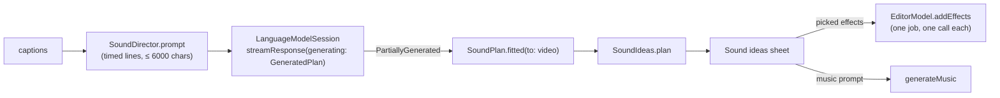

# Sound ideas (on-device Foundation Models)

> **At a glance**
> - **Suggest sounds** in the editor sends the captions to the Apple Intelligence model on the device. It
>   streams back a plan: up to six sound effects, each placed at the line that calls for it, and one prompt
>   for background music. The user ticks what to keep; only then does ElevenLabs generate anything.
> - Planning is free, offline and private. Generating the picked sounds costs credits as before.
> - The planner lives in the kit (`Director/`): `SoundDirector` (prompt, session, streaming), `SoundPlan`
>   (the plan and `fitted(to:)`), `SoundDirectorError` (every failure with a message). The app reaches it only
>   through `EditorServices.planSounds`, so tests and CI never touch the model.

## The model and its limits

Measured on an M1 Pro Mac (macOS 26.6) and the iOS 26.5 simulator:

| | |
|---|---|
| Context | 4096 tokens for instructions, transcript and answer together |
| Languages | da, de, en, es, fr, it, ja, ko, nb, nl, pt, sv, tr, vi, zh. **Not ru or uk** |
| Speed | first request after a while: ~10 s before the first token, ~20 s in all; warm: ~1 s, ~3 s |
| Where it runs | devices with Apple Intelligence turned on; macOS 26 with it on; the iOS 26 simulator on a macOS 26 host |

> **Decision.** Plan from the captions, not from the audio or the script.
> **Why.** Captions exist in both modes (transcribed takes, or the speech's alignment in Type mode) and carry
> start times, which is what placing an effect needs.
> **Rejected.** The typed script: no times, and nothing at all in Record mode.

> **Decision.** Ask the model for a `cue` (the words that call for the sound) before each effect's start and prompt.
> **Why.** Properties are generated in declaration order. Quoting the line first ties the effect to something
> actually said; without it the model invented doors, footsteps and ringing phones and ignored the storm the
> transcript was about. The cue is also shown to the user, so a suggestion can be judged at a glance.

> **Decision.** Treat every number from the model as a suggestion: `SoundPlan.fitted(to:)` clamps starts into
> the video, lengths into 0.5–22 s (what sound generation accepts) and not past the end, drops blank and
> repeated prompts, keeps at most six, and sorts.
> **Why.** `@Guide(.range)` constrains decoding but not meaning; a start past the end still decodes fine.

> **Decision.** Run planning outside `WorkRunner`'s job slot, in `SoundIdeas`, and show its failures in the sheet.
> **Why.** It spends nothing and changes nothing, so it must not block an export or raise the editor's alert;
> closing the sheet cancels it.

> **Decision.** Check availability and language before the request, and still classify the request's own error.
> **Why.** The iOS 27.2 simulator on a macOS 26 host reports the model as `.available` and then fails every
> request with "Simulator is not supported". In Record mode the recording language is known, so an unsupported
> one gets a clear message up front; a typed script may be in any language, so there the model's
> `unsupportedLanguageOrLocale` is mapped instead.

> **Decision.** The sheet is presented by `EditorView`, not by the section's row; a run that is superseded
> (a second `suggest` while the first streams) returns without touching the state; `prewarm` runs off the main actor.
> **Why.** Each one was a bug seen on the simulator: the form rebuilt the row and dismissed the sheet mid-plan;
> a cancelled `for try await` ends like a finished stream, so the old run reported "No ideas" over the new one;
> loading the model on the main actor swallowed the first tap on the freshly opened editor.

## Long videos

The transcript is cut at 6000 characters (about 1,500 English tokens) and the model is told the rest exists, so a
long video gets ideas for its beginning instead of `exceededContextWindowSize`. Planning in windows and merging
the plans is the upgrade path if that becomes a real limit.

## Adding the picked effects

`addEffects` generates the effects one by one in a single job and keeps each one as it lands, so a failure halfway
keeps what was paid for and the edit is rebuilt with it. Its retry passes the whole selection again and skips
effects already on the lane (same prompt, same start), so nothing is billed twice.

## Testing

- Kit, no model: the request text, the cut, `fitted(to:)`, error messages (`SoundDirectorTests`).
- Kit, real model: `SoundDirectorLiveTests` is opt-in and needs Apple Intelligence on the machine. It prints
  the plan, which is the quickest way to judge a prompt change:
  `VOICEOVER_LIVE_MODEL=1 swift test --filter SoundDirectorLive` in `Packages/VoiceoverKit`.
  It stays out of the default run because the model's timing is not stable: the same prompt took from 6 seconds
  to over a minute, and about one run in three hit the one-minute limit.
- App: `SoundIdeasTests` stubs `planSounds` and the HTTP transport: streaming, language, failures, partial
  success and retry.
- By hand: the iOS 26.5 simulator on this Mac (see known issues for why not 27.2), or a device.
