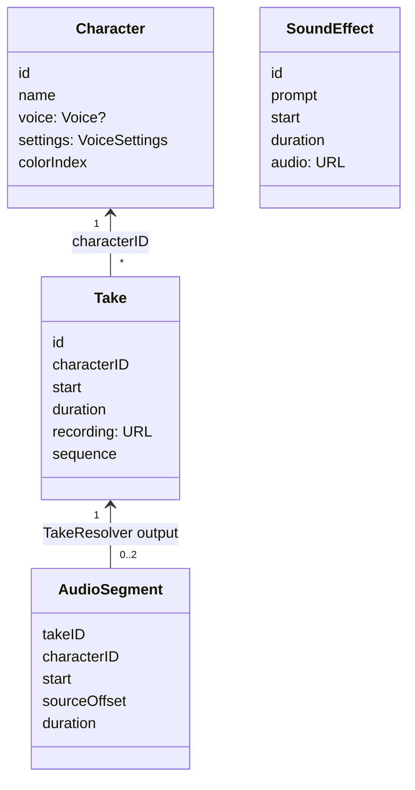
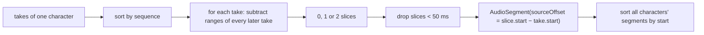
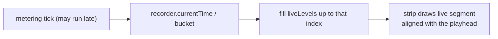
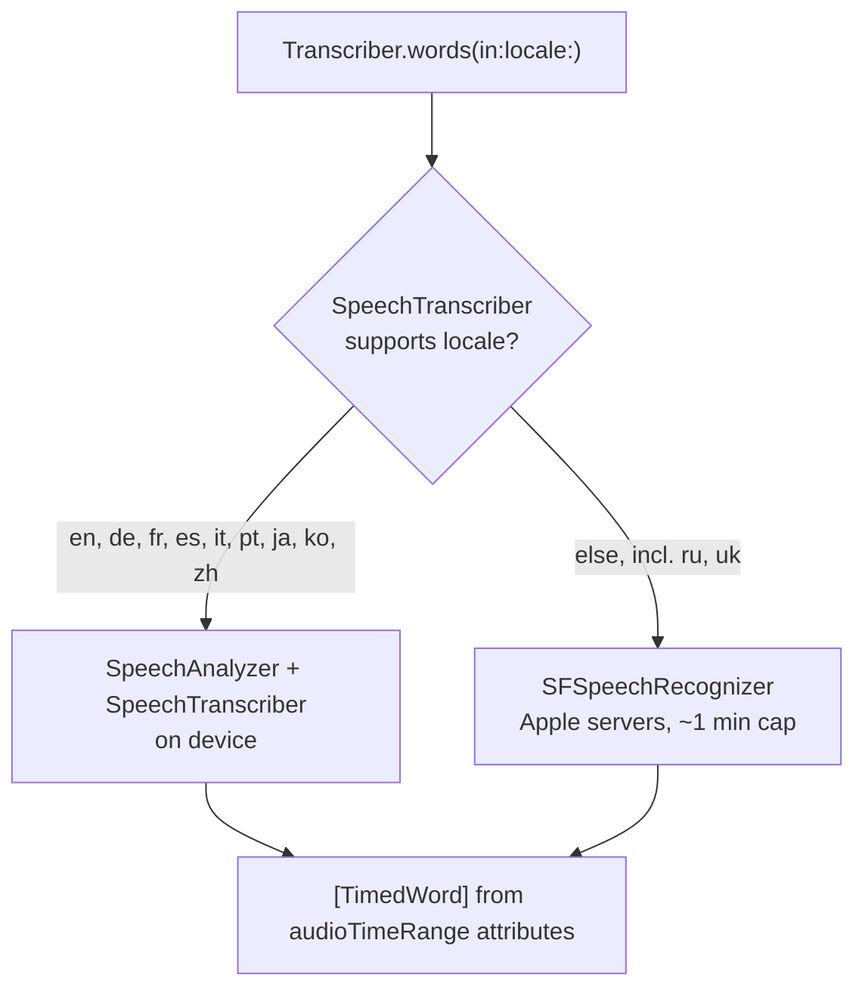
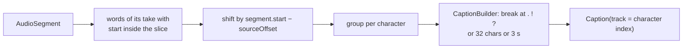
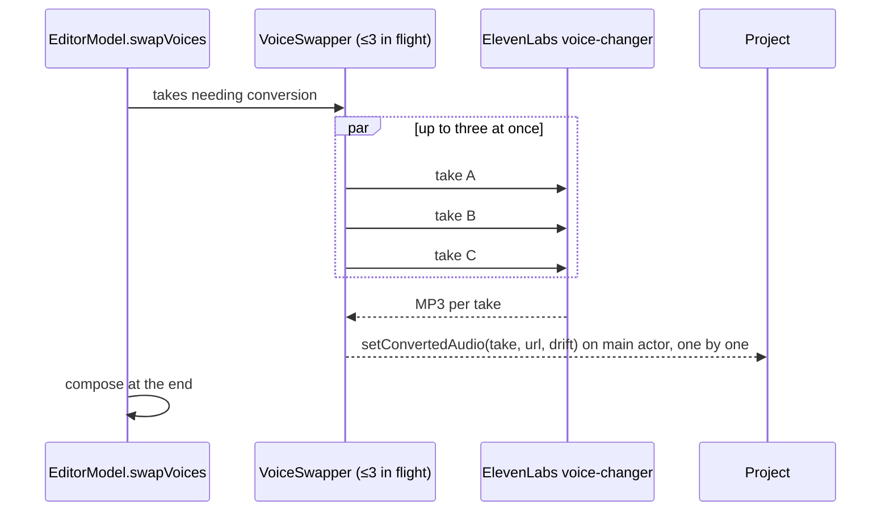
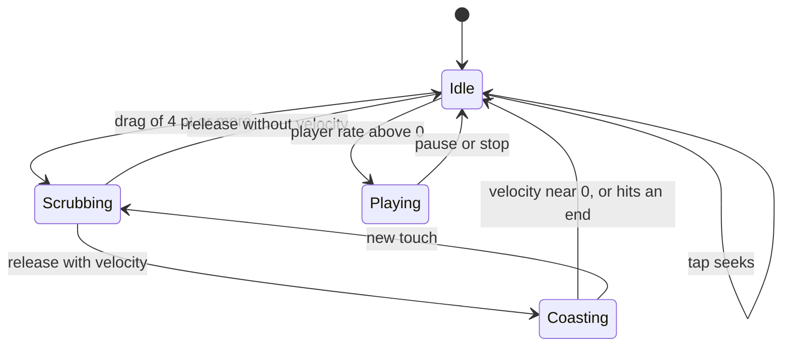

# Takes, characters and the timeline

> **At a glance**
> - A take is never edited on disk. `TakeResolver` computes the audible slices; everything downstream (composer,
>   captions, lanes) reads slices.
> - Within one character the **newest take wins** where they overlap. Characters never cut each other.
> - Live meter and stored waveform share one linear scale, so the trace does not change shape at Stop.
> - Two transcription engines behind one function, chosen by locale.
> - The scrubber is a `TimelineView`, not a `ScrollView`: position per frame from the player's clock.

## 1. Model



- `sequence` is the recording order and the only thing that decides precedence.
- `start` is where the user pressed Record on the timeline; `duration` is what the recorder measured at Stop.

## 2. Overlap resolution (`TakeResolver`, kit, tested)

```
timeline  0s        2s        4s        6s        8s
take 1    [=========================]              seq 1
take 2              [=========]                    seq 2 (punch-in)
result    [ t1 ---- ][ t2 ---- ][ t1 ][            3 segments
          off 0       off 0      off 4s
```



> **Decision.** Resolution is computed, never written back to files.
> **Why.** Nothing is destructive: deleting the newer take brings the older one back whole. The same resolution
> feeds the composer, the captions and the lanes, so they can never disagree.

## 3. Recording (`TakeRecorder`)

| Setting | Value |
|---|---|
| Format | AAC, 44.1 kHz, mono, high quality |
| File | `take-<uuid>.m4a` in the project folder |
| Permission | `AVAudioApplication.requestRecordPermission()` |
| Metering | `peakPower` sampled every 20 ms (`Waveform.bucket`) |
| Minimum length | `TakeResolver.minimumDuration`; shorter takes are discarded and their file deleted |



> **Decision.** `liveLevels` is filled **up to the recorder's own clock**, not by tick count.
> **Why.** When the timer runs late the trace used to lag behind the playhead. Filling by clock keeps them aligned.

Double-tap protection: `start(in:)` refuses while a recorder exists, and `EditorModel.isStartingRecording` covers
the gap while the microphone prompt is up. Otherwise the first recorder kept metering into `liveLevels` with no one
to stop it.

**End of the video.** A take ends by itself when the video does: `RecordingSession` holds a `PlaybackEndWatcher`
while recording, and the model stops the take as if Stop had been pressed on the last frame. Record pressed within
half a second of the end rewinds to the start first.

> **Decision.** The watcher listens to every `didPlayToEndTime` and compares the item with the player's *current*
> one when it fires.
> **Why.** A recompose finishing just after Record swaps the player's item; an observer bound to the old item
> would never fire and the take would run on over a frozen frame, as it did before.

## 4. Waveforms (`Waveform`)

| Source | Conversion |
|---|---|
| Stored file | `AVAssetReader` → 16 kHz mono 16-bit PCM → peak per 20 ms bucket → linear × 1.6, clipped to 1 |
| Live meter | dBFS → `Waveform.level(fromDecibels:)` → same linear scale |

> **Decision.** One scale for both.
> **Why.** Earlier the live meter was dB-linear and the stored waveform was normalised to its own maximum. The trace
> changed shape the moment Stop was pressed.

Waveforms are not persisted; they are recomputed at utility priority when a project opens.
`levels(from:duration:count:)` resamples a slice for drawing, so a split take draws the right part.

## 5. Transcription (`Transcriber`)



Things that cost time to learn:

1. Call `AssetInventory.reserve(locale:)` **before** `assetInstallationRequest`, or the request fails with
   "not subscribed to transcription.en".
2. `analyzeSequence(from:)` + `finalizeAndFinish(through:)` leaves `transcriber.results` open forever. Use
   `start(inputAudioFile:finishAfterFile: true)`. Verified with synthesized speech.
3. `SFTranscription` is not `Sendable`: convert to `[TimedWord]` *inside* the callback.
4. A lock-guarded `ResumeOnce` protects the continuation from a second callback.
5. `withTaskCancellationHandler` cancels the `SFSpeechRecognitionTask` with the Swift task (deleted take, closed
   editor). Otherwise the request kept streaming to the server for up to a minute.

The recording language is a setting (`RecordingLanguage`, UserDefaults), defaulting to the device locale.

## 6. Captions from takes (`CaptionAssembler`, kit, tested)



Two people talking at once render on two lines because each character has its own `track`. Ids are unique across
characters.

## 7. Voice swap (`VoiceSwapper`)



> **Decision.** Each take is sent separately.
> **Why.** Cheaper than one flattened file (no silence billed), and a retry re-sends one take, not all.

The converted MP3 replaces the recording in `voiceClips()`. The length difference is `conversionDrift`, flagged
above 150 ms because captions are timed from the recording. Changing a character's voice or settings invalidates
only that character's conversions.

## 8. The scrubber (`TimelineStrip`)

A Photos-style strip: content slides under a fixed playhead.



| State | Source of position |
|---|---|
| Scrubbing | finger translation 1:1 to time, `pointsPerSecond = 56` |
| Coasting | `coast(velocity:)`, UIScrollView's curve: ×0.998 per ms, stepped at 120 Hz |
| Playing | `TimelineView(.animation)` reads `player.currentTime()` every display frame |
| Idle | `currentTime` passed in by the owner after seeks, stops, first appearance |

Seeks issued while scrubbing are **coalesced** in `RecordingView`: one in flight, only the newest pending time is
honoured, tolerance 1/30 s. Without that a 60 fps clip lagged behind the finger.

> **Decision.** `TimelineView` + `.offset`, not `ScrollView` + `ScrollPosition`.
> **Why.** The scroll version animated one long linear scroll during playback. Smooth, but the animation outlived a
> pause and the strip kept moving after a take stopped. `TimelineView` has no such state.

Lanes: one per character in declaration order with the resolved segments (tinted block + waveform, identified by
the whole `AudioSegment` value), a live segment in full colour while recording, one Effects lane with prompt text.
The trim range is shown by dimming the strip outside it.
